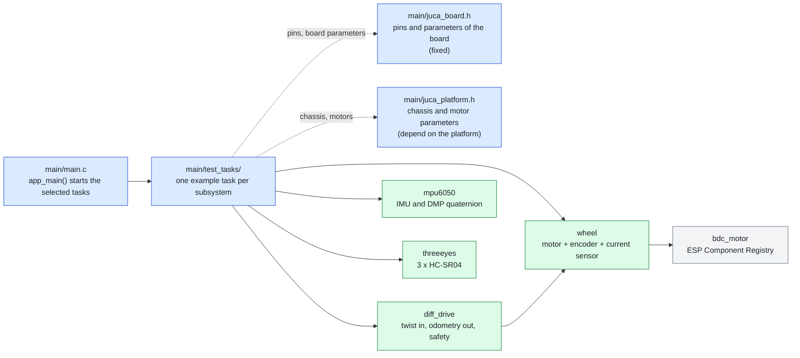

# Juca firmware

Firmware of **Juca**, a small two-wheeled, differential-drive robot. It runs on an **ESP32-S3** with **ESP-IDF v5.3.1** and FreeRTOS.

The repository holds the drivers for every part of the robot (motors, encoders, current sensors, IMU, ultrasonic sensors, line sensors), a differential-drive layer on top of the motor driver, and one small example task per subsystem. `app_main()` starts the example tasks you enable; see [`main/test_tasks`](main/test_tasks/README.md).

## Hardware

The board and the peripherals the firmware is written for:

| Subsystem | Part |
|---|---|
| Controller | ESP32-S3 |
| Motor driver | L298N dual H-bridge, driven with two PWM signals per motor |
| Motor current | A shunt resistor with an amplifier on each motor channel, read by two ADC1 channels |
| Orientation | MPU6050 IMU on I2C |
| Distance | 3 x HC-SR04 ultrasonic sensors |
| Line following | 5 infrared sensors |

All pins, and the parameters of the board itself, are defined in [`juca_board.h`](main/juca_board.h). Until their components are migrated, the HC-SR04 pins are still in [`threeeyes.h`](components/threeeyes/include/threeeyes.h) and those of the line sensors in [`ir_line.h`](main/ir_line.h).

## Tested platform

The motors, the encoders and the dimensions of the chassis are **not fixed by the firmware**. This is the platform Juca was developed and tested on, and the one the examples and the measurements in [`docs/`](docs) refer to:

| Part | What was used |
|---|---|
| Motors | DC gear motors, 6 V, 280 rpm (nominal), reduction about 1:20.46 |
| Encoders | Quadrature, 11 pulses per motor turn: 900 counts per wheel turn when decoded at 4x |
| Wheels and chassis | Wheel radius 0.03 m, distance between the wheels 0.30 m |
| Battery | 7.6 V nominal pack |
| Motor duty cap | 350 of 400 PWM ticks (87.5%) |

The drivers do not know any of this: `wheel` and `diff_drive` receive it through their configuration structures. The `diff_drive` example takes the values from [`juca_platform.h`](main/juca_platform.h) (`JUCA_WHEEL_RADIUS_M`, `JUCA_HALF_TRACK_WIDTH_M`, `JUCA_ENCODER_CPR_LEFT` and `JUCA_ENCODER_CPR_RIGHT`, `JUCA_MOTOR_MAX_POWER_TICKS`). To use other motors, wheels or a different chassis, change that file and run the `diff_drive` calibration again. [`juca_board.h`](main/juca_board.h), with the pins and the parameters of the board, stays the same.

## Software architecture



Blue is the application (`main/`), green are the reusable components (`components/`) and gray is a package downloaded from the ESP Component Registry. An arrow means "calls", except the dotted ones, which mean "takes pins and parameters from".

Two rules keep the layers clean:

- **Components never include `juca_board.h` or `juca_platform.h`.** They receive pins and constants through a configuration structure (`wheel_config_t`, `diff_drive_config_t`), so each one can be reused on another board.
- **Only the application knows the robot.** The board, the platform and the tuning choices are set in `main/`.

### Components

| Component | What it does | Documentation |
|---|---|---|
| [`wheel`](components/wheel) | One motorized wheel: DC motor driven by MCPWM, quadrature encoder read by the pulse counter (PCNT), motor current read by the ADC. Encoder and current sensing are optional | [Open-loop wheel tests](docs/wheel_open_loop_tests.md) |
| [`diff_drive`](components/diff_drive) | Open-loop differential drive on top of two wheels: velocity command in (`linear_x`, `angular_z`), odometry out, acceleration ramp, automatic calibration and overcurrent protection | [README](components/diff_drive/README.md) |
| [`mpu6050`](components/mpu6050) | MPU6050 driver: raw accelerometer and gyroscope, and the DMP (on-chip sensor fusion) for the orientation quaternion | Source |
| [`threeeyes`](components/threeeyes) | Three HC-SR04 sensors triggered together and measured in parallel with the MCPWM capture peripheral | Source |

The infrared line follower is not a component yet: it is read directly from GPIO by [`ir_line_task.c`](main/test_tasks/ir_line_task.c), with its pins in [`ir_line.h`](main/ir_line.h).

### Dependencies

Declared in [`main/idf_component.yml`](main/idf_component.yml) and downloaded automatically by the first build (internet access needed):

| Package | Version | Used by |
|---|---|---|
| `espressif/bdc_motor` | ^0.1.0 | `wheel` |
| `espressif/pid_ctrl` | ^0.1.1 | Declared and included, but no code calls it today |

## Repository layout

```
.
├── CMakeLists.txt
├── sdkconfig.defaults        target = esp32s3
├── main/
│   ├── CMakeLists.txt
│   ├── idf_component.yml     registry dependencies
│   ├── main.c                app_main(): starts the tasks enabled by #define
│   ├── juca_board.h          pins and fixed parameters of the Juca board
│   ├── juca_platform.h       chassis and motor parameters (tested platform)
│   ├── ir_line.h             pins and patterns of the line follower
│   └── test_tasks/           one example task per subsystem (has its own README)
├── components/
│   ├── diff_drive/
│   ├── wheel/
│   ├── mpu6050/
│   └── threeeyes/
└── docs/                     measurements and reports
```

## Getting started

You need ESP-IDF v5.3.1 installed and loaded in your shell, and the robot connected over USB. The repository also has a `.devcontainer` based on the official ESP-IDF image.

```
idf.py set-target esp32s3        # only the first time
idf.py build flash monitor
```

If the board is not found automatically, add the serial port: `idf.py -p <PORT> flash monitor`.

Notes:

- The CMake project is still named `go_and_avoid`, so the binaries come out as `build/go_and_avoid.bin` and `build/go_and_avoid.elf`.
- `sdkconfig` is not versioned; only `sdkconfig.defaults` is. Choose the console that matches your cable in `idf.py menuconfig`, under *Component config, ESP System Settings, Channel for console output* (UART or USB Serial/JTAG). The interactive examples work with either.

### Running something on the robot

`main()` does nothing by itself: it starts the example tasks enabled in [`main/main.c`](main/main.c). Pick one, rebuild and flash. How to choose it, how to combine tasks, and the safety checklist for the ones that move the robot are in [`main/test_tasks/README.md`](main/test_tasks/README.md).

## Configuration

Two kinds of settings, kept apart on purpose:

- **Build-time driver options**, in `idf.py menuconfig`: *Wheel Driver Configuration* (PWM frequency, timer resolution, encoder counter limit and glitch filter) and *MPU6050 Driver* (I2C port, pins, clock, timeout, calibration loops). `diff_drive` has no menu; it is configured entirely through its configuration structure.
- **Board, platform and tuning**, in the code: the pins and fixed parameters of the board in [`juca_board.h`](main/juca_board.h), the chassis and motor parameters of the [tested platform](#tested-platform) in [`juca_platform.h`](main/juca_platform.h), and the tuning choices (speed limits, ramps, overcurrent threshold, task priorities) in each example task.

## Documentation

| Document | What it covers |
|---|---|
| [`main/test_tasks/README.md`](main/test_tasks/README.md) | The example tasks: what each one is for, how to enable it and how to run it safely |
| [`components/diff_drive/README.md`](components/diff_drive/README.md) | The differential-drive component: API, kinematics, acceleration ramp, calibration, overcurrent protection |
| [`docs/wheel_open_loop_tests.md`](docs/wheel_open_loop_tests.md) | Measurements with the wheels in the air: open-loop speed curves, motor and driver electrical characterisation, current-sensor calibration |

## Conventions

- **Names:** `snake_case` everywhere. Functions are `<component>_<verb>_<object>` (for example `wheel_get_encoder_count`, `diff_drive_set_twist`). Constants of the board and of the platform are `JUCA_*`, and only in `juca_board.h` and `juca_platform.h`.
- **Units in the name:** `_m`, `_m_s`, `_rad_s`, `_m_s2`, `_ms`, `_ticks`, so the unit is never a guess.
- **Frame and signs:** `linear_x` is positive forward, `angular_z` is positive counter-clockwise, as in a ROS `Twist`.
- **Language:** documentation and new code comments in English.
- `wheel`, `diff_drive` and `mpu6050` already follow the naming convention. `threeeyes` and the line follower still use older names and will be migrated.

## Known limitations

- **Open-loop drive.** `diff_drive` has no velocity feedback: the encoders are used for odometry and for the start-up calibration, not to correct the motors. At low speeds the measured velocity is below the commanded one.
- **Calibration is not stored.** It lives in RAM and is repeated at every boot, with the robot moving.