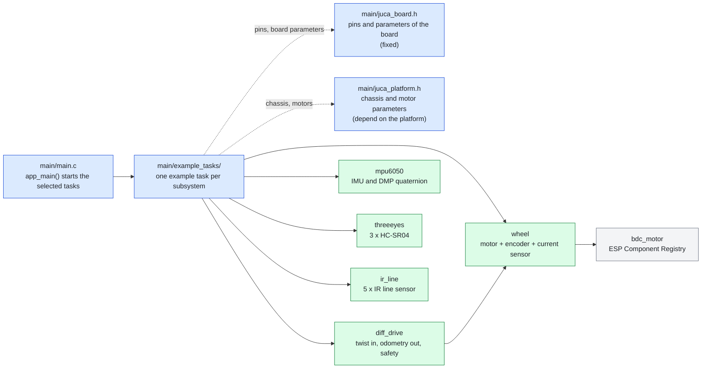

# Juca firmware

Firmware of **Juca**, a small two-wheeled, differential-drive robot. It runs on an **ESP32-S3** with **ESP-IDF v5.3.1** or **ESP-IDF v5.3.6** and FreeRTOS.

The repository holds the drivers for every part of the robot (motors, encoders, current sensors, IMU, ultrasonic sensors, line sensors), a differential-drive layer on top of the motor driver, and one small example task per subsystem. `app_main()` starts the example tasks you enable; see [`main/example_tasks`](main/example_tasks/README.md).

## Hardware

The board and the peripherals the firmware is written for:

| Subsystem | Part |
|---|---|
| Controller | ESP32-S3 |
| Motor driver | L298N dual H-bridge, driven with two PWM signals per motor |
| Motor current | A shunt resistor with an amplifier on each motor channel, read by two ADC1 channels |
| Orientation | MPU6050 IMU on I2C |
| Distance | 3 x HC-SR04 ultrasonic sensors |
| Line following | 5 digital infrared sensors |

All pins, and the parameters of the board itself, are defined in one place: [`juca_board.h`](main/juca_board.h).

| Subsystem | Pins (GPIO) |
|---|---|
| Left motor PWM A / B | 12 / 13 |
| Right motor PWM A / B | 11 / 10 |
| Left encoder A / B | 7 / 6 |
| Right encoder A / B | 21 / 14 |
| Current sensors left / right | 9 / 2 (ADC1 channels 8 and 1) |
| IMU I2C SDA / SCL | 40 / 39 |
| HC-SR04 TRIG (shared) / ECHO left, middle, right | 42 / 5, 4, 1 |
| Line sensors, far left to far right | 15, 16, 17, 18, 8 |

## Tested platform

The motors, the encoders and the dimensions of the chassis are **not fixed by the firmware**. This is the platform Juca was developed and tested on, and the one the examples and the measurements in [`docs/`](docs) refer to:

| Part | What was used |
|---|---|
| Motors | DC gear motors, 6 V, 280 rpm (nominal), reduction about 1:20.46 |
| Encoders | Quadrature, 11 pulses per motor turn: 900 counts per wheel turn when decoded at 4x |
| Wheels and chassis | Wheel radius 0.03 m, distance between the wheels 0.30 m |
| Supply | 7.6 V; about 5.2 V reaches the motors through the L298N |
| Motor duty cap | 400 of 400 PWM ticks (no cap) |

The drivers do not know any of this: `wheel` and `diff_drive` receive it through their configuration structures. The examples take the values from [`juca_platform.h`](main/juca_platform.h) (`JUCA_WHEEL_RADIUS_M`, `JUCA_HALF_TRACK_WIDTH_M`, `JUCA_ENCODER_CPR_LEFT` and `JUCA_ENCODER_CPR_RIGHT`, `JUCA_MOTOR_MAX_POWER_TICKS`). To use other motors, wheels or a different chassis, change that file and run the `diff_drive` calibration again. [`juca_board.h`](main/juca_board.h), with the pins and the parameters of the board, stays the same.

Measured on this platform, wheels in the air: the top speed at full duty is about 30 rad/s (left) and 29 rad/s (right), and the motors do not turn below about 24% of duty (dead zone). See [`docs/wheel_open_loop_tests.md`](docs/wheel_open_loop_tests.md).

## Software architecture



Blue is the application (`main/`), green are the reusable components (`components/`) and gray is a package downloaded from the ESP Component Registry. An arrow means "calls", except the dotted ones, which mean "takes pins and parameters from".

Two rules keep the layers clean:

- **Components never include `juca_board.h` or `juca_platform.h`.** They receive pins and constants through a configuration structure or through arguments (`wheel_config_t`, `diff_drive_config_t`, `threeeyes_config_t`, `ir_line_config_t`, the arguments of `mpu6050_complete_init()`), so each one can be reused on another board.
- **Only the application knows the robot.** The board, the platform and the tuning choices are set in `main/`.

### Components

| Component | What it does | Documentation |
|---|---|---|
| [`wheel`](components/wheel) | One motorized wheel: DC motor driven by MCPWM, quadrature encoder read by the pulse counter (PCNT), motor current read by the ADC. Encoder and current sensing are optional | [Open-loop wheel tests](docs/wheel_open_loop_tests.md) |
| [`diff_drive`](components/diff_drive) | Open-loop differential drive on top of two wheels: velocity command in (`linear_x`, `angular_z`), odometry out, acceleration ramp, automatic calibration and overcurrent protection | [README](components/diff_drive/README.md) |
| [`mpu6050`](components/mpu6050) | MPU6050 driver: raw accelerometer and gyroscope, and the DMP (on-chip sensor fusion) for the orientation quaternion | [README](components/mpu6050/README.md) |
| [`threeeyes`](components/threeeyes) | Three HC-SR04 sensors triggered together and measured in parallel with the MCPWM capture peripheral; returns the nearest object | [README](components/threeeyes/README.md) |
| [`ir_line`](components/ir_line) | Five digital infrared line sensors read as one 5-bit mask, with the polarity hidden | [README](components/ir_line/README.md) |

### Dependencies

Declared in [`main/idf_component.yml`](main/idf_component.yml) and downloaded automatically by the first build (internet access needed):

| Package | Version | Used by |
|---|---|---|
| `espressif/bdc_motor` | ^0.1.0 | `wheel` |
| `espressif/pid_ctrl` | ^0.1.1 | Declared, but no code calls it today (the speed PID of the `diff_drive` example has its own controller) |

## Repository layout

```
.
├── CMakeLists.txt
├── sdkconfig.defaults        target = esp32s3, console = USB Serial/JTAG
├── main/
│   ├── CMakeLists.txt
│   ├── idf_component.yml     registry dependencies
│   ├── main.c                app_main(): starts the tasks enabled by #define
│   ├── juca_board.h          pins and fixed parameters of the Juca board
│   ├── juca_platform.h       chassis and motor parameters (tested platform)
│   └── example_tasks/        one example task per subsystem (has its own README)
├── components/
│   ├── diff_drive/
│   ├── wheel/
│   ├── mpu6050/
│   ├── threeeyes/
│   └── ir_line/
└── docs/                     measurements and reports
```

## Getting started

You need ESP-IDF installed and loaded in your shell (or the ESP-IDF extension of VS Code), and the robot connected over USB.

**Use ESP-IDF v5.3.6** (any v5.3 from v5.3.4 on). The code also builds with v5.3.1, but the pulse-counter driver of v5.3.1 to v5.3.3 has a race when it reads the encoder count: rarely, one odometry sample comes out one counter limit (7000 counts) off, a spike of about ±15 m/s. Espressif fixed it in v5.3.4, so updating needs no change in this repository.

```
idf.py set-target esp32s3        # only the first time
idf.py build flash monitor
```

If the board is not found automatically, add the serial port: `idf.py -p <PORT> flash monitor`.

Notes:

- The binaries come out as `build/juca_firmware.bin` and `build/juca_firmware.elf`.
- `sdkconfig` is not versioned; only `sdkconfig.defaults` is. It selects the **USB Serial/JTAG** console, which is the native USB port of the ESP32-S3. If your cable goes to a USB-to-UART chip instead, choose *UART* in `idf.py menuconfig`, under *Component config, ESP System Settings, Channel for console output*. The interactive examples work with either.
- After moving or replacing files of a component, run `idf.py fullclean` before building, so that no stale object or header is reused.

### Running something on the robot

`app_main()` does nothing by itself: it starts the example tasks enabled in [`main/main.c`](main/main.c). Pick one, rebuild and flash. How to choose it, how to combine tasks, and the safety checklist for the ones that move the robot are in [`main/example_tasks/README.md`](main/example_tasks/README.md).

| Task | Enable with | Moves the robot? | Documentation |
|---|---|---|---|
| Differential drive, console commands (with optional speed PID) | `DIFF_DRIVE_TASK` | **Yes** | [README_diff_drive.md](main/example_tasks/README_diff_drive.md) |
| Wheels, low-level test | `WHEEL_CTRL_TASK` | **Yes** | [wheel_task.h](main/example_tasks/wheel_task.h) |
| IMU (quaternion, angles or acceleration) | `IMU_TASK` | No | [README_imu.md](main/example_tasks/README_imu.md) |
| Ultrasonic sensors | `THREE_EYES_TASK` | No | [README_threeeyes.md](main/example_tasks/README_threeeyes.md) |
| Line sensors | `IR_LINE_TASK` | No | [README_ir_line.md](main/example_tasks/README_ir_line.md) |
| Line follower with obstacle detour | `LINE_AVOID_TASK` | **Yes** | Header comment of [line_avoid_task.c](main/example_tasks/line_avoid_task.c) |

Run the sensor tasks first (wheels, line sensors, ultrasonic sensors, IMU) to check the wiring, and only then the ones that drive the robot.

## Configuration

Two kinds of settings, kept apart on purpose:

- **Build-time driver options**, in `idf.py menuconfig`: *Wheel Driver Configuration* (PWM frequency, timer resolution, encoder counter limit and glitch filter). The other components have no menu; they are configured entirely through their configuration structures or arguments.
- **Board, platform and tuning**, in the code: the pins and fixed parameters of the board in [`juca_board.h`](main/juca_board.h), the chassis and motor parameters of the [tested platform](#tested-platform) in [`juca_platform.h`](main/juca_platform.h), and the tuning choices (speed limits, ramps, PID gains, overcurrent threshold, task priorities) in each example task.

## Documentation

| Document | What it covers |
|---|---|
| [`main/example_tasks/README.md`](main/example_tasks/README.md) | The example tasks: what each one is for, how to enable it and how to run it safely |
| [`components/diff_drive/README.md`](components/diff_drive/README.md) | The differential-drive component: API, kinematics, acceleration ramp, calibration, overcurrent protection |
| [`components/mpu6050/README.md`](components/mpu6050/README.md) | The IMU driver: bring-up, DMP, calibration, sensor settings |
| [`components/threeeyes/README.md`](components/threeeyes/README.md) | The ultrasonic sensors: one measurement, the "first echo" rule, conversion to centimeters |
| [`components/ir_line/README.md`](components/ir_line/README.md) | The line sensors: the 5-bit mask, the patterns, from the mask to a line position |
| [`docs/wheel_open_loop_tests.md`](docs/wheel_open_loop_tests.md) | Measurements with the wheels in the air: open-loop speed curves, motor and driver electrical characterisation, current-sensor calibration |

## Conventions

- **Names:** `snake_case` everywhere. Functions are `<component>_<verb>_<object>` (for example `wheel_get_encoder_count`, `diff_drive_set_twist`, `threeeyes_trigger_and_wait`). Types end in `_t` and macros are in capitals. Constants of the board and of the platform are `JUCA_*`, and only in `juca_board.h` and `juca_platform.h`.
- **Units in the name:** `_m`, `_m_s`, `_rad_s`, `_m_s2`, `_ms`, `_ticks`, `_cm`, so the unit is never a guess.
- **Frame and signs:** `linear_x` is positive forward, `angular_z` is positive counter-clockwise, as in a ROS `Twist`.
- **Errors:** functions return `esp_err_t`; initializations release what they created when a step fails.
- **Language:** documentation and code comments in English.

## Known limitations

- **Open-loop drive.** `diff_drive` has no velocity feedback: the encoders are used for odometry and for the start-up calibration, not to correct the motors. At low speeds the measured velocity is below the commanded one, and below about 0.2 m/s the motors do not turn. The `diff_drive` example shows a speed PID on top of the component (`SPEED_PID_ENABLE`); its gains are starting values, not tuned on the robot.
- **Calibration is not stored.** It lives in RAM and is repeated at every boot, with the robot moving.
- **Overcurrent protection at low duty.** The current sensors see the PWM-chopped average, so a stalled wheel at low or medium duty may stay below the threshold and not be detected.
- **Ultrasonic sensors report the nearest object only.** One measurement returns at the first echo; the other two sensors are not measured in that call.
- **IMU yaw drifts.** The MPU6050 has no magnetometer.
