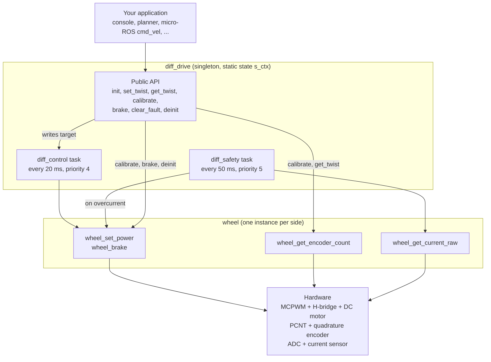
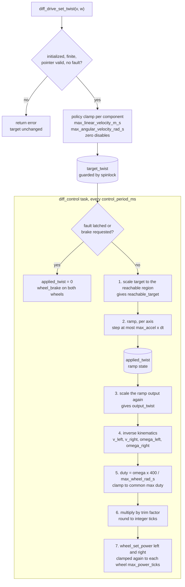
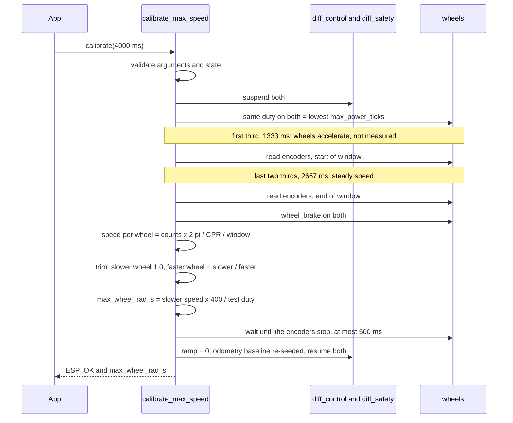
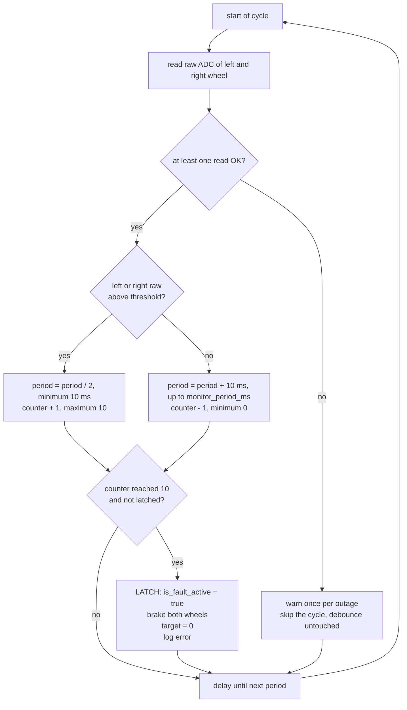
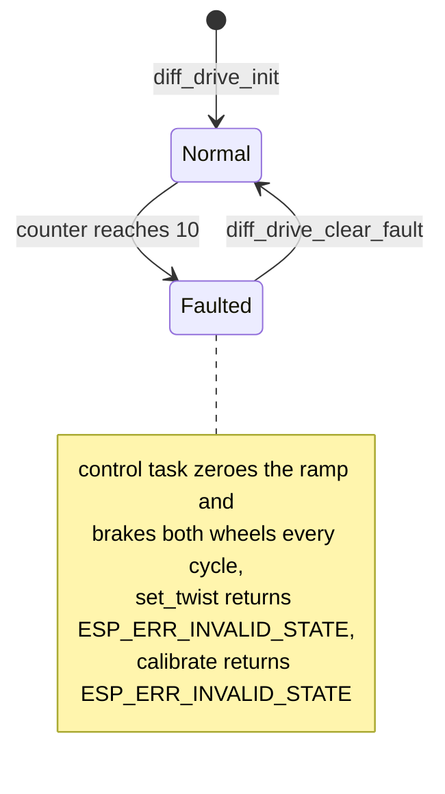
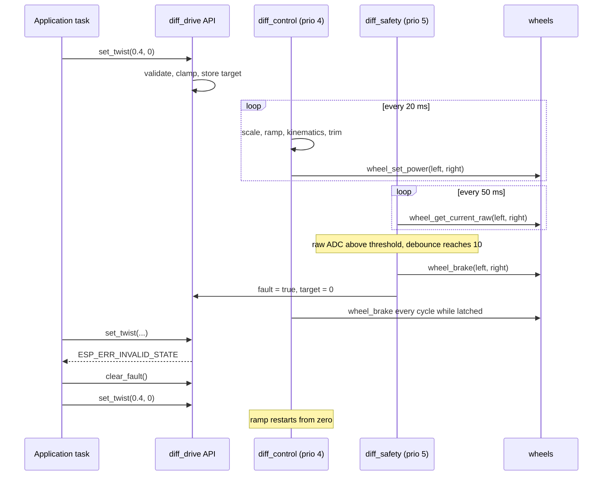
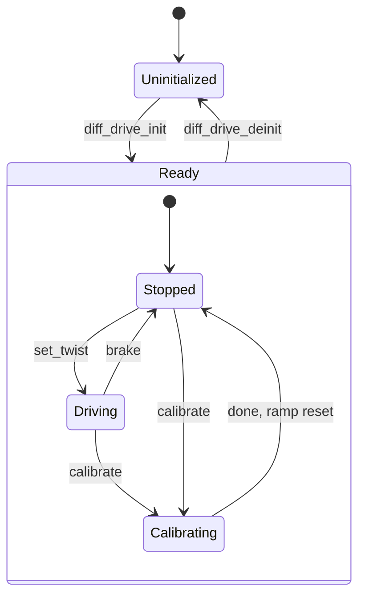

# diff_drive component

Open-loop differential-drive layer for ESP-IDF and FreeRTOS. You give it a velocity command (`linear_x` in m/s, `angular_z` in rad/s, the same convention as a ROS `Twist`). It turns the command into signed PWM duty for two `wheel` instances, protects the motors against overcurrent, calibrates itself against the encoders, and reports the velocity the robot really has.

Developed for ESP-IDF v5.3.1 on an ESP32-S3 (the Juca robot). It depends on the `wheel` component in this repository.

**Contents**

1. [What it does (and does not)](#1-what-it-does-and-does-not)
2. [Architecture](#2-architecture)
3. [Quick start](#3-quick-start)
4. [Conventions: frame, signs, units](#4-conventions-frame-signs-units)
5. [Configuration reference](#5-configuration-reference)
6. [API reference](#6-api-reference)
7. [How it works](#7-how-it-works)
   - [7.1 Kinematics](#71-kinematics)
   - [7.2 The control pipeline](#72-the-control-pipeline)
   - [7.3 Reachable-speed limit](#73-reachable-speed-limit)
   - [7.4 Acceleration ramp](#74-acceleration-ramp)
   - [7.5 Calibration and trim](#75-calibration-and-trim)
   - [7.6 Odometry](#76-odometry)
   - [7.7 Overcurrent protection](#77-overcurrent-protection)
   - [7.8 Brake](#78-brake)
   - [7.9 Tasks and concurrency](#79-tasks-and-concurrency)
   - [7.10 Lifecycle](#710-lifecycle)
8. [Error codes](#8-error-codes)
9. [Reading the logs](#9-reading-the-logs)
10. [What to expect from an open-loop robot](#10-what-to-expect-from-an-open-loop-robot)
11. [Testing](#11-testing)
12. [Limitations and gotchas](#12-limitations-and-gotchas)
13. [Files](#13-files)

---

## 1. What it does (and does not)

| It does | It does not |
|---|---|
| Inverse kinematics: `(linear_x, angular_z)` to left and right wheel duty | Close a speed loop: there is **no PID**. Duty is proportional to the commanded wheel speed, nothing corrects it |
| Forward kinematics: encoder counts to measured `(linear_x, angular_z)` | Integrate pose (x, y, heading). `diff_drive_get_twist` returns velocities only |
| Acceleration ramp on both axes, so commands never step | Persist calibration. Trim and `max_wheel_rad_s` live in RAM and are lost on reset |
| Scales a command that the wheels cannot reach, keeping its curvature | Plan paths or avoid obstacles |
| Auto-calibration: one pulse measures the slower wheel's top speed and a trim that makes both wheels match | Support more than one instance: the module is a singleton |
| Overcurrent / stall protection with a hard latch, in its own higher-priority task | Know your wiring: it assumes positive power makes both encoders count up (see [4](#4-conventions-frame-signs-units)) |

The encoders are used for **odometry and calibration only**. During normal driving the command goes to the motors without feedback, so what the robot does depends on the calibration and on the load (see [10](#10-what-to-expect-from-an-open-loop-robot)).

---

## 2. Architecture



- `diff_drive` never touches a peripheral. Everything goes through `wheel` handles that **you** create and pass in, so the pins and the ADC unit stay in your application (the repository keeps them in `main/juca_board.h`).
- The application talks only to the public API. `diff_drive_set_twist` stores a target; the **control task** is the only code that turns targets into motor power while driving.
- Component dependencies (`CMakeLists.txt`): `driver`, `log`, `wheel`.

---

## 3. Quick start

```c
#include "diff_drive.h"
#include "esp_check.h"
#include "esp_log.h"

static const char *TAG = "app";

/* left_wheel and right_wheel come from wheel_create(); see the wheel component. */
void drive_demo(wheel_handle_t left_wheel, wheel_handle_t right_wheel)
{
    /* 1. Configure and initialize. Values below are the Juca robot's. */
    const diff_drive_config_t config = {
        .left_wheel  = left_wheel,
        .right_wheel = right_wheel,

        .half_track_width_m = 0.15f,      /* h = L/2: 0.30 m between the wheel ground contacts */
        .wheel_radius_m     = 0.03f,
        .left_encoder_cpr   = 900,        /* counts per wheel revolution, 4x decoding, after the gearbox */
        .right_encoder_cpr  = 900,

        .max_linear_velocity_m_s    = 0.8f,   /* policy limits; 0.0f disables each one */
        .max_angular_velocity_rad_s = 2.0f,
        .max_wheel_rad_s            = 20.0f,  /* initial estimate at 100% duty; calibration replaces it */

        .max_adc_raw_threshold  = 3000,   /* 0 disables the safety task */
        .monitor_period_ms      = 50,
        .safety_task_priority   = 5,
        .safety_task_stack_size = 3072,

        .max_accel_linear_m_s2    = 0.5f, /* <= 0 disables the ramp on that axis */
        .max_accel_angular_rad_s2 = 1.5f,
        .control_period_ms        = 20,
        .control_task_priority    = 4,    /* must be lower than the safety task's */
        .control_task_stack_size  = 3072,
    };
    ESP_ERROR_CHECK(diff_drive_init(&config));

    /* 2. Calibrate (optional, recommended). The robot MOVES for the whole pulse and the safety task is suspended. */
    float max_wheel_rad_s = 0.0f;
    esp_err_t err = diff_drive_calibrate_max_speed(4000, &max_wheel_rad_s);
    if (err == ESP_OK) {
        ESP_LOGI(TAG, "calibrated: %.2f rad/s at 100%% duty", max_wheel_rad_s);
    } else {
        ESP_LOGW(TAG, "calibration failed (%s), keeping the configured estimate", esp_err_to_name(err));
    }

    /* 3. Command a velocity. Returns at once; the control task does the rest. */
    const diff_drive_twist_t command = { .linear_x = 0.4f, .angular_z = 0.0f };
    ESP_ERROR_CHECK(diff_drive_set_twist(&command));

    /* 4. Telemetry and fault handling, from ONE task. */
    TickType_t last_wake_tick = xTaskGetTickCount();
    TickType_t previous_tick = last_wake_tick;
    for (;;) {
        vTaskDelayUntil(&last_wake_tick, pdMS_TO_TICKS(50));

        if (diff_drive_is_fault_active()) {
            /* Overcurrent: wheels are braked and the target was discarded. Decide when it is safe to go on. */
            ESP_ERROR_CHECK(diff_drive_clear_fault());
            ESP_ERROR_CHECK(diff_drive_set_twist(&command));    /* a new command is required after a fault */
            previous_tick = xTaskGetTickCount();
            continue;
        }

        TickType_t now_tick = xTaskGetTickCount();
        float delta_time_s = (float)(now_tick - previous_tick) * portTICK_PERIOD_MS / 1000.0f;
        previous_tick = now_tick;

        diff_drive_twist_t measured;
        if (delta_time_s > 0.0f && diff_drive_get_twist(delta_time_s, &measured) == ESP_OK) {
            ESP_LOGI(TAG, "v = %.3f m/s, w = %.3f rad/s", measured.linear_x, measured.angular_z);
        }
    }
}
```

A complete, runnable version with an interactive serial console is in `main/test_tasks/diff_drive_task.c` (or `main/example_tasks/`, depending on your tree).

To stop: `diff_drive_brake()` (immediate, and the robot stays stopped until the next `set_twist`) or `diff_drive_set_twist` with zeros (the ramp brings it down). To shut the module down: `diff_drive_deinit()`.

---

## 4. Conventions: frame, signs, units

```
                    x   (forward, linear_x > 0)
                    ^
                    |
   left wheel       |       right wheel
   +-------+        |        +-------+
   |       |        |        |       |
   |  v_l  |        |        |  v_r  |       v_l = linear_x - angular_z * h
   |   ^   |        |        |   ^   |       v_r = linear_x + angular_z * h
   +-------+        |        +-------+
  y <---------------o---------------        h = half_track_width_m  (L / 2)
   (left)  |<-- h ->|<-- h ->|              z points up, out of the page
```

- `angular_z > 0` is **counter-clockwise seen from above**: the right wheel goes faster, the robot turns **left**.
- `linear_x > 0` is forward, which means **positive wheel power** on both wheels.
- Units are SI, with the unit in the name: `_m`, `_m_s`, `_rad_s`, `_m_s2`, `_rad_s2`, `_ms`, `_ticks`.
- **Duty** is expressed in PWM timer ticks. Full scale is `WHEEL_PWM_DUTY_TICK_MAX`, written $`T_{\max}`$ below: $`T_{\max} = f_{\text{timer}} / f_{\text{PWM}} = 10\ \mathrm{MHz} / 25\ \mathrm{kHz} = 400`$ (`CONFIG_WHEEL_TIMER_RESOLUTION_HZ / CONFIG_WHEEL_PWM_FREQ_HZ`).
- **Encoder sign:** `diff_drive_get_twist` uses signed counts and assumes they increase when a wheel is driven forward. If one side counts down, odometry on that side is inverted; swap that wheel's A and B encoder pins in `wheel_config_t`. Calibration uses absolute counts, so it does not notice this.
- `half_track_width_m` is **half** of the distance between the wheels (L/2). The formulas in this document use $`h`$ for it.

---

## 5. Configuration reference

`diff_drive_config_t` is copied into the module at `diff_drive_init`; you can free or reuse it afterwards. The `wheel` handles are **not** copied by value, they stay yours.

| Field | Unit | Meaning | If 0 / notes |
|---|---|---|---|
| `left_wheel`, `right_wheel` | handle | Initialized `wheel` instances | NULL is `ESP_ERR_INVALID_ARG` |
| `half_track_width_m` | m | h = L/2 | must be > 0 |
| `wheel_radius_m` | m | Rolling radius r | must be > 0 |
| `left_encoder_cpr`, `right_encoder_cpr` | counts/rev | Counts per **wheel** revolution, 4x quadrature, after the gearbox. May differ per side | 0 means no encoder: odometry and calibration are refused (driving still works) |
| `max_linear_velocity_m_s` | m/s | Policy clamp on `linear_x`, applied in `set_twist` | 0 disables |
| `max_angular_velocity_rad_s` | rad/s | Policy clamp on `angular_z` | 0 disables |
| `max_wheel_rad_s` | rad/s | Wheel speed at 100% duty. Sets the duty-per-rad/s scale **and** the reachable-speed limit. Calibration overwrites it | must be > 0 |
| `max_adc_raw_threshold` | ADC raw | Overcurrent threshold, compared with the raw reading of each wheel | 0 disables the safety task and the priority rule |
| `current_ma_per_count` | mA/count | Factor that converts a raw current reading to mA, same for both wheels. Used only by `diff_drive_get_current_ma` | 0 means unknown: that function returns `ESP_ERR_INVALID_STATE`. Must be finite and >= 0. The Juca value (0.271) is for the left channel at 100% duty |
| `monitor_period_ms` | ms | Safety task period | 0 gives 50 |
| `safety_task_priority` | FreeRTOS | Priority of `diff_safety` | 0 gives 5 |
| `safety_task_stack_size` | bytes | Stack of `diff_safety` | 0 gives 3072 |
| `max_accel_linear_m_s2` | m/s^2 | Ramp rate on `linear_x` | <= 0 disables the ramp on this axis |
| `max_accel_angular_rad_s2` | rad/s^2 | Ramp rate on `angular_z` | <= 0 disables the ramp on this axis |
| `control_period_ms` | ms | Control task period | 0 gives 20. Rounded **down** to whole RTOS ticks, at least 1 tick |
| `control_task_priority` | FreeRTOS | Priority of `diff_control` | 0 gives 4. Must be **strictly lower** than the safety task's whenever the safety task runs |
| `control_task_stack_size` | bytes | Stack of `diff_control` | 0 gives 3072 |

**Three different limits** act on a command; do not confuse them:

| Limit | Where | What it is for |
|---|---|---|
| `max_linear_velocity_m_s`, `max_angular_velocity_rad_s` | `set_twist`, **per component** | Your policy: "this robot may never go faster than this" |
| Reachable speed (from `max_wheel_rad_s`) | control task, **whole twist** | Physics: what the wheels can deliver. See [7.3](#73-reachable-speed-limit) |
| `max_power_ticks` of each `wheel` | `wheel_set_power` | Hardware: duty cap per motor. It also lowers the reachable-speed limit |

**No Kconfig.** The component has no `menuconfig` menu: it is configured only through `diff_drive_config_t`, so there is one place for each value. Keep the constants of your robot (track width, wheel radius, CPR, current factor) in your application, for example in two headers like the ones of the Juca project: `main/juca_board.h` (pins and parameters of the board) and `main/juca_platform.h` (chassis and motors), and fill the struct from them.

---

## 6. API reference

| Function | What it does | Notes |
|---|---|---|
| `diff_drive_init(config)` | Validates, copies the config, starts `diff_control` and (if enabled) `diff_safety` | Call once. Not safe to call from two tasks at once |
| `diff_drive_deinit()` | Stops both tasks, brakes both wheels, marks the module uninitialized | Waits up to `control_period_ms + monitor_period_ms + 100` ms, then deletes a stuck task. Does **not** delete the wheels |
| `diff_drive_is_initialized()` | `true` after a successful init | |
| `diff_drive_calibrate_max_speed(ms, &out)` | Moves the robot for `ms` (500 to 10000), computes trim and `max_wheel_rad_s` | Blocks. Suspends both tasks. See [7.5](#75-calibration-and-trim) |
| `diff_drive_set_twist(&twist)` | Validates, clamps by policy, stores the target | Fast, non-blocking, **any task, any rate**. Does not touch hardware |
| `diff_drive_get_twist(dt, &out)` | Measured velocity from the encoders since the previous call | Stateful: call from **one** task |
| `diff_drive_get_current_raw(&left, &right)` | Raw ADC counts of the current sensor of each wheel, returned by reference | Any task. Raw counts, not mA |
| `diff_drive_get_current_ma(&left, &right)` | Current of each wheel in mA (`float`), returned by reference: raw count times `current_ma_per_count` | Any task. Only as good as the configured factor; see the note in `diff_drive.h` |
| `diff_drive_brake()` | Brakes both wheels now, discards target and ramp | Any task |
| `diff_drive_is_fault_active()` | `true` while the overcurrent latch is set | Any task. Returns `false` if not initialized |
| `diff_drive_clear_fault()` | Releases the latch | Any task. The target was already discarded: send a new `set_twist` |

Two constants: `DIFF_DRIVE_CALIBRATION_MIN_DURATION_MS` (500) and `DIFF_DRIVE_CALIBRATION_MAX_DURATION_MS` (10000).

`diff_drive_twist_t` is `{ float linear_x; float angular_z; }`, used both for commands and for telemetry.

---

## 7. How it works

### 7.1 Kinematics

Symbols used in the equations of this document:

| Symbol | In the code | Unit |
|---|---|---|
| $`v_x`$, $`\omega_z`$ | `linear_x`, `angular_z` (the twist) | m/s, rad/s |
| $`h`$ | `half_track_width_m` (L/2) | m |
| $`r`$ | `wheel_radius_m` | m |
| $`v_L`$, $`v_R`$ | linear speed of the left / right wheel | m/s |
| $`\omega_L`$, $`\omega_R`$ | angular speed of the left / right wheel | rad/s |
| $`\omega_{\max}`$ | `max_wheel_rad_s` | rad/s |
| $`T_{\max}`$ | `WHEEL_PWM_DUTY_TICK_MAX` (400) | duty ticks |
| $`P_{\max}`$ | `common_max_power_ticks` | duty ticks |
| $`k_L`$, $`k_R`$ | `left_trim_factor`, `right_trim_factor` | none |
| $`\Delta n_i`$ | `delta_counts` of a wheel since the previous sample | counts |
| $`\mathrm{CPR}_i`$ | `left_encoder_cpr`, `right_encoder_cpr` | counts per wheel turn |
| $`\Delta t`$ | `dt` | s |

Inverse (command to wheels), per control cycle:

```math
\begin{aligned}
v_L &= v_x - \omega_z\,h \\
v_R &= v_x + \omega_z\,h
\end{aligned}
\qquad [\mathrm{m/s}]
```

```math
\omega_L = \frac{v_L}{r}, \qquad \omega_R = \frac{v_R}{r} \qquad [\mathrm{rad/s}]
```

Then, for each wheel $`i \in \{L, R\}`$:

```math
\begin{aligned}
s &= \frac{T_{\max}}{\omega_{\max}} && \text{(duty ticks per rad/s)} \\
n_i &= \operatorname{clamp}\!\left(s\,\omega_i,\; -P_{\max},\; +P_{\max}\right) && \text{(nominal duty)} \\
p_i &= \operatorname{round}\!\left(k_i\,n_i\right) && \text{(duty ticks, signed)}
\end{aligned}
```

$`P_{\max}`$ is the lower of the two wheels' `max_power_ticks`, read once at init.

Forward (encoders to chassis), in `diff_drive_get_twist`. For each wheel $`i \in \{L, R\}`$, with its own CPR:

```math
d_i = \Delta n_i\,\frac{2\pi r}{\mathrm{CPR}_i}, \qquad v_i = \frac{d_i}{\Delta t}
```

and then the chassis twist:

```math
v_x = \frac{v_R + v_L}{2}, \qquad \omega_z = \frac{v_R - v_L}{2h}
```

**Worked example** with the calibration of a real run of the Juca robot (`max_wheel_rad_s = 26.17`, trim left 1.000 and right 0.967, wheels capped at 350 of 400 duty ticks), $`r = 0.03\ \mathrm{m}`$, $`h = 0.15\ \mathrm{m}`$. The scale is $`s = 400 / 26.17 \approx 15.28`$ duty ticks per rad/s.

| Command | v_left, v_right (m/s) | omega_left, omega_right (rad/s) | Nominal duty L / R | After trim, rounded |
|---|---|---|---|---|
| `(0.40, 0.00)` straight | 0.40, 0.40 | 13.33, 13.33 | 203.8 / 203.8 | **204 / 197** (51% / 49%) |
| `(0.20, 1.00)` turning left | 0.05, 0.35 | 1.67, 11.67 | 25.5 / 178.3 | **25 / 172** |

### 7.2 The control pipeline



| Step | Function | Why it exists |
|---|---|---|
| Policy clamp | `diff_drive_set_twist` | Your speed limits, enforced as soon as the command arrives |
| 1. Scale target | `scale_twist_to_wheel_limit` | The ramp must not climb towards a speed the wheels cannot reach ([7.3](#73-reachable-speed-limit)) |
| 2. Ramp | `apply_ramp` | No step changes in duty ([7.4](#74-acceleration-ramp)) |
| 3. Scale output | `scale_twist_to_wheel_limit` | The two axes ramp independently, so a point between two reachable twists may not be reachable |
| 4 to 6. Kinematics, scale, trim | `apply_twist` | Section [7.1](#71-kinematics). The nominal duty is clamped **before** the trim, otherwise a saturated command would put both wheels at the same duty and the trim would do nothing |
| 7. Dispatch | `wheel_set_power` | Sign gives direction; zero is an active brake |

`apply_twist` does not clamp the twist and does not check faults: those are done by its callers. Its own duty clamp is a safety net: after step 3 the nominal duty is at most the limit, plus float rounding (measured across the whole test suite: at most 0.00003 ticks over, which `round` absorbs).

### 7.3 Reachable-speed limit

A wheel cannot turn faster than `max_wheel_rad_s` times the fraction of duty it is allowed to use. If a command asks for more, one wheel saturates, and, without this limit, three things go wrong:

- the robot goes **no faster** than the saturated speed, but the ramp keeps climbing towards the raw target ("wind-up");
- after you ask it to stop, the wheels stay at full power until the ramp comes back down to the saturation point;
- on a combined command only the faster wheel saturates, so the robot turns **tighter** than asked.

The faster wheel of a twist runs at $`\dfrac{\lvert v_x\rvert + \lvert\omega_z\rvert\,h}{r}`$, so the reachable region is a rhombus in the $`(v_x, \omega_z)`$ plane:

```math
\lvert v_x\rvert + \lvert\omega_z\rvert\,h \;\le\; r\,\omega_{\max}\,\frac{P_{\max}}{T_{\max}}
```


A command inside the rhombus is not touched. A command outside it has **both** components multiplied by the same factor, which moves it along its own ray to the edge: same curvature, lower speed.

| `max_wheel_rad_s` | Duty cap of the wheels | Fastest wheel allowed | Pure linear max | Pure spin max |
|---|---|---|---|---|
| 26.17 rad/s (the real run) | 350 of 400 | 0.687 m/s | 0.687 m/s | 4.58 rad/s |
| 26.17 rad/s (same estimate, no cap) | 400 of 400 | 0.785 m/s | 0.785 m/s | 5.23 rad/s |

Example from the figure (the real run): `(0.60, 2.00)` passes a 0.8 m/s and 2.0 rad/s policy clamp, but the outer wheel would need $`0.60 + 2.00 \times 0.15 = 0.90\ \mathrm{m/s}`$. The factor is $`0.687 / 0.90 = 0.763`$, so the robot is driven at `(0.46, 1.53)`, along the same curve.

After a calibration the limit is not an extrapolation: the pulse runs at the same common duty cap, so the limit is exactly the speed that was **measured** for the slower wheel at that duty (22.90 rad/s in the real run, which is $`26.17 \times 350 / 400`$).

The limit is evaluated **every control cycle** from the current `max_wheel_rad_s`: the configured estimate until calibration, the measured value after it, and it follows the duty cap of the wheels. It cuts the top end only where the duty would saturate anyway, so a single-axis command ends at the same duty as before. What changed is the ramp state and the slower wheel on combined commands.

Effect on a spin command of 10 rad/s with `max_wheel_rad_s = 27.33` and no duty cap (policy limits disabled, 1.5 rad/s^2), in the host simulator:

| | Without the limit | With the limit |
|---|---|---|
| Ramp (`angular_z`) | climbs to 10.0 | stops at 5.47 |
| Wheels leave full power after a stop command | +3.1 s | +0.1 s |
| Wheels at zero after a stop command | +6.7 s | +3.7 s |

### 7.4 Acceleration ramp

Each axis moves towards its (scaled) target by at most $`a_{\max}\,\Delta t`$ per control cycle (`max_accel` times the control period). The two axes are independent; `max_accel <= 0` makes that axis jump straight to the target.

`dt` is the period the RTOS **really** provides, not the requested one: `period_ticks * portTICK_PERIOD_MS`. With a 10 ms tick, a requested 25 ms period runs every 20 ms and the ramp step uses 20 ms. A period shorter than one tick is raised to one tick (otherwise `vTaskDelayUntil` would return at once and the task would spin).

Example: `max_accel_linear_m_s2 = 0.5` takes 0.8 s to go from 0 to 0.4 m/s. The ramp state (`applied_twist`) is owned by the control task alone, so it needs no lock. It is reset to zero by a brake request, by a latched fault, and at the end of a calibration.

If the control task misses periods (for example both tasks are suspended during calibration), `delay_until_period` resynchronizes to "now" instead of catching up, so the ramp does not advance dozens of steps in one instant.

### 7.5 Calibration and trim

Two motors never match. `diff_drive_calibrate_max_speed` measures how much they differ and fixes two things:

- **trim factors**, a per-wheel multiplier below or equal to 1 that slows the faster wheel until both match, so that equal commands drive straight;
- **`max_wheel_rad_s`**, the true speed of the slower wheel at 100% duty, so the duty scale is right.



Details that matter:

- Both wheels get the **same** duty, so their speeds are directly comparable. That duty is the lowest `max_power_ticks` of the two wheels: a higher value would be clamped silently and the measured speed would not correspond to the duty used in the extrapolation.
- The result is extrapolated **linearly** to 100% duty. A real motor has a dead zone and is not perfectly linear (see [10](#10-what-to-expect-from-an-open-loop-robot)), so the trim is exact at the test duty and approximate elsewhere. The test duty is the wheels' own cap, so lowering `max_power_ticks` in `wheel` also moves the calibration point.
- **The robot moves** for the whole pulse, and the safety task is **suspended**: there is no overcurrent protection until the function returns. That is why the duration is capped at 10 s. Keep at least 2 m of clear floor.
- Trim and `max_wheel_rad_s` are **RAM only**. Call the function again after every reset, or save the values yourself (for example in NVS).
- A target registered **before** the calibration is kept: after it ends, the control task starts ramping from zero towards it. Calibrate before the first `set_twist` if you do not want that.
- Results differ from run to run (for example 27.33 and 26.17 rad/s on the same robot on different days), by a few percent.

### 7.6 Odometry

`diff_drive_get_twist(dt, &out)` reads both encoder counts, subtracts the previous sample, and applies the forward formulas of [7.1](#71-kinematics). It returns **velocity**, not pose.

- `dt` must be the real time since the previous call. Use the tick counter, not the nominal period.
- The previous sample is kept in the module: call it from **one task only**.
- The baseline is set at `diff_drive_init` and again at the end of each calibration (so a calibration run does not show up as a speed spike). The first call after either should cover the time since then; if you are not sure, discard the first sample.
- The values are noisy at low speed: one encoder count is $`2\pi r / \mathrm{CPR} = 0.21\ \mathrm{mm}`$ of wheel travel with the Juca numbers, so at 20 Hz one count on one wheel is `0.004 m/s` of that wheel's speed. Average a few samples if you need a clean number.
- `dt <= 0` or non-finite is `ESP_ERR_INVALID_ARG`; a zero CPR on either side is `ESP_ERR_INVALID_STATE`.

### 7.7 Overcurrent protection

The `diff_safety` task samples the raw current ADC of both wheels. It runs only if `max_adc_raw_threshold > 0`.



The counter is a debounce: it climbs while the current is high and **decays** while it is low, so a short spike does not trip it, and a sustained overload does. While the current is high the task also polls faster (down to 10 ms), to react sooner.



**The latch is hard**: it does not release by itself when the current drops (which it does at once, because the brake stops the motor). An earlier version released it automatically; the robot then tried to resume its last command, stalled again, tripped again, and jerked on and off. Now the application must call `diff_drive_clear_fault()` (ideally after checking that whatever blocked the robot is gone) and then send a **new** `set_twist`, because the latch also discards the target.

If neither wheel can be read (no current sensor wired, or an ADC error), the task logs one warning per outage and keeps running, but **it is not protecting anything**.

### 7.8 Brake

`diff_drive_brake()` does four things, in this order:

1. discards the target (so no later control cycle ramps towards it);
2. asks the control task to zero the ramp;
3. brakes both wheels immediately, **both** even if the first reports an error;
4. returns the first error, if any.

The robot then stays stopped, because the control task keeps commanding zero power (an active brake), until the next `set_twist`. A control cycle that was already running can re-apply its previous power once; the next cycle, at most `control_period_ms` later, restores the brake.

### 7.9 Tasks and concurrency

| Task | Name | Default priority | Default period | Stack | Runs |
|---|---|---|---|---|---|
| Control | `diff_control` | 4 | 20 ms | 3072 bytes | Always |
| Safety | `diff_safety` | 5 | 50 ms (10 to 50 ms adaptive) | 3072 bytes | Only if `max_adc_raw_threshold > 0` |

`diff_drive_init` returns `ESP_ERR_INVALID_ARG` if the control priority is not strictly lower than the safety priority (when the safety task runs). The reason is that the safety task must always be able to preempt the control task and brake, even in the middle of a control cycle.



Shared state and who owns it:

| State | Written by | Read by | Protection |
|---|---|---|---|
| `target_twist`, `is_brake_requested` | `set_twist`, `brake`, safety task (zeroes the target) | control task | spinlock `s_twist_spinlock` |
| `is_fault_active` | safety task (set), `clear_fault` (clear) | control task, `set_twist`, API | spinlock `s_safety_flag_spinlock` |
| `applied_twist` (ramp state) | control task; also reset by `calibrate` while the task is suspended | control task | none needed (single owner) |
| `max_wheel_rad_s`, trim factors | `calibrate` while both tasks are suspended; `init` | control task | none needed (tasks suspended) |
| Encoder baseline | `get_twist`, `init`, `calibrate` | `get_twist` | none: single caller by contract |

The spinlocks are `portMUX_TYPE`, which are correct on the dual-core ESP32-S3. The critical sections only copy a few floats.

`set_twist`, `brake`, `is_fault_active` and `clear_fault` can be called from any task at any rate. `init`, `deinit` and `calibrate` are **not** protected against concurrent calls: call them from one task. `get_twist` must have one caller.

### 7.10 Lifecycle



After a calibration the robot is at rest and the ramp is zero; if a target was stored before it, the control task starts ramping towards it again.

`diff_drive_init`:

1. rejects a second call, a NULL config or wheel, a non-positive geometry or `max_wheel_rad_s`;
2. reads each wheel's `max_power_ticks` and keeps the lower one;
3. resets trim to 1.0, clears the fault, zeroes target and ramp, seeds the encoder baseline;
4. checks the priority rule, then starts `diff_control`, then `diff_safety`;
5. if the second task cannot be created, tells the first to exit and returns `ESP_FAIL`, so init fails as a whole.

`diff_drive_deinit` tells both tasks to leave their loops and waits for them to delete themselves (bounded, then forces the deletion), **then** brakes both wheels. Braking last matters: a task still running could otherwise re-energize a wheel after the brake. The module can be initialized again afterwards. The `wheel` instances stay allocated: delete them with `wheel_delete` yourself.

---

## 8. Error codes

| Function | `ESP_ERR_INVALID_STATE` | `ESP_ERR_INVALID_ARG` | Others |
|---|---|---|---|
| `init` | already initialized | NULL config or wheel; `half_track_width_m` or `wheel_radius_m` <= 0; `max_wheel_rad_s` <= 0; `current_ma_per_count` negative or not finite; control priority not below safety priority | `ESP_FAIL` if a task cannot be created; errors from `wheel_get_max_power_ticks` |
| `deinit` | not initialized | | |
| `calibrate_max_speed` | not initialized; either CPR is 0; fault latched; a wheel has `max_power_ticks` 0 | duration outside 500 to 10000 ms | `ESP_ERR_INVALID_RESPONSE` if a wheel produced zero encoder counts; errors from `wheel_set_power` |
| `set_twist` | not initialized; fault latched | NULL pointer; NaN or Inf component | |
| `get_twist` | not initialized; either CPR is 0 | NULL pointer; `dt` <= 0 or not finite | errors from `wheel_get_encoder_count` (encoder disabled on that wheel) |
| `get_current_raw` | not initialized | NULL output pointer | first error of `wheel_get_current_raw` (e.g. a wheel without current sensor), after reading both wheels |
| `get_current_ma` | not initialized; `current_ma_per_count` is 0; a wheel without current sensor (that output is 0) | NULL output pointer | first ADC driver error, after reading both wheels (that output is 0) |
| `brake` | not initialized | | first `wheel_brake` error, after trying both wheels |
| `clear_fault` | not initialized | | |

---

## 9. Reading the logs

All messages use the tag `diff_drive`.

| Message | Level | Meaning |
|---|---|---|
| `Differential drive module initialized successfully.` | I | `init` finished |
| `Starting maximum speed auto-calibration pulse (4000 ms at 350 of 400 duty ticks)...` | I | The robot is about to move. The duty is the lowest `max_power_ticks` of the wheels |
| `Measured uncompensated wheel speeds at test duty -> Left: ..., Right: ...` | I | Raw speeds at the test duty, before trim |
| `Calibration completed. Trim Factors -> Left: ..., Right: ... \| Calibrated Speed at 100% duty: ... rad/s` | I | The new trim and `max_wheel_rad_s` are in effect |
| `Calibration failed: Zero encoder ticks detected...` | E | A wheel did not turn: motor unplugged, jammed, or encoder wiring |
| `OVERCURRENT DETECTED! Left ADC: ..., Right ADC: ... Emergency brake activated!...` | E | The latch was set |
| `Motion command rejected: Overcurrent system fault is currently active!` | W | `set_twist` during a fault (logged on every call) |
| `Fault cleared by application -- safety task re-armed.` | I | After `clear_fault` |
| `Current sensing unavailable on both wheels...` | W | The safety task has nothing to read: **no protection** |
| `Timed out waiting for background tasks to exit; forcing deletion.` | W | `deinit` had to kill a task |
| `Maximum wheel angular velocity must be > 0` | E | `max_wheel_rad_s` was 0 (or negative) at `init` |

---

## 10. What to expect from an open-loop robot

Because there is no speed loop, the real speed follows the duty through the motor's own curve. Measured on the Juca prototype (6 V, 280 rpm, 11 pulses per revolution, reduction about 1:20.46) with the **wheels in the air**, steady state:

| Commanded `linear_x` (m/s) | 0.2 | 0.3 | 0.4 | 0.5 | 0.6 | 0.7 | 0.8 | 1.0 | 1.2 |
|---|---|---|---|---|---|---|---|---|---|
| Measured (m/s) | 0.000 | 0.145 | 0.275 | 0.411 | 0.539 | 0.655 | 0.775 | 0.895 | 0.904 |

These numbers belong to that session's calibration (they move by a few percent between runs, and depend on the duty cap used for the calibration pulse).

- There is a **dead zone** of about 25% duty: below it the motor does not turn.
- Above it the speed is close to linear in duty, with an offset, so a low command lands **below** the requested value (0.4 asked, 0.275 measured) while a high one lands close to it.
- The top speed saturates at about 0.90 m/s (nominal 280 rpm on a 0.03 m wheel is 0.88 m/s). Commands above that are scaled by the reachable-speed limit.
- With the wheels in the air the load is only friction. Measurements under load were not made.

The full method and the tables are in [`docs/wheel_open_loop_tests.md`](../../docs/wheel_open_loop_tests.md) (adjust the path to where the report lives in your tree).

If you need the robot to hit a requested speed, add a speed loop **on top of** this component: read `diff_drive_get_twist`, compare with your target, and feed the correction back through `diff_drive_set_twist`.

---

## 11. Testing

`test_host/` runs the real `diff_drive.c`, `wheel.c` and the example on your PC with `gcc`, with no ESP32 and no ESP-IDF. It includes a cooperative priority scheduler on a simulated 10 ms tick and fake wheels with a first-order motor model (so the ramp, the tasks, the safety latch, the calibration and the odometry all run for real).

```bash
./test_host/run_tests.sh                  # core 31/31, example 2/2, wheel PASS
python3 test_host/mutants/run_mutants.py  # about 4 min: 36 mutants, all must be caught
```

| Group | What it checks |
|---|---|
| Kinematics and odometry | Inverse kinematics against the simulated wheel speeds, `get_twist` with equal and unequal CPR, CPR 0 on one side |
| Safety | Latch, rejection of commands, clear and resume; no busy loop when the ADC fails; one sensor missing |
| Brake | Holds after brake; brake racing a control cycle; both wheels braked even if one fails |
| Calibration | Speed scale, steady window, no catch-up burst on resume, unequal power limits, unequal CPR, failure paths |
| Ramp | Slope, settling, tick-rounded period, clamps |
| Reachable-speed limit | Unit cases of the scaling; no wind-up; same curve; no unreachable transient; follows the calibration |
| Trim | Still effective when the command saturates |
| Lifecycle | Init, deinit, init again; forced deletion of a stuck task |

**Mutation testing** re-introduces, one at a time, each bug that was fixed (and errors in the new logic), and checks that at least one test fails. All 36 are caught.

What this does **not** prove: it is not a test on hardware (the motor is a first-order model: no dead zone, no noise, no friction), and it does not replace `idf.py build` (the PC compiler uses stub headers; Xtensa toolchain warnings can appear only in the real build).

---

## 12. Limitations and gotchas

- **Open loop.** The achieved speed depends on the calibration, the battery voltage and the load. See [10](#10-what-to-expect-from-an-open-loop-robot).
- **`max_wheel_rad_s` is also a cap until you calibrate.** Without calibration it is both the duty scale and the reachable-speed limit. Set it close to the real value, or calibrate.
- **Calibration moves the robot and disables protection** while it runs; its result is lost at reset and varies by a few percent between runs.
- **One instance.** The state is a static singleton; a second robot needs a second copy of the component.
- **`get_twist` has one caller** and needs the real `dt`. It returns velocity, not pose.
- **A fault discards the target.** After `clear_fault` the robot stays stopped until the next `set_twist`.
- **`set_twist` during a fault** returns an error and logs a warning on every call; do not call it at a high rate while `diff_drive_is_fault_active()` is true.
- **Brake window.** After `diff_drive_brake()` a control cycle already in flight can re-apply its previous power once: up to `control_period_ms` of residual motion.
- **The policy limits are per component.** A command can pass both and still exceed what the wheels can do; the reachable-speed limit then scales it.
- **No notice when a command is scaled.** The robot may follow a smaller twist than the one you sent; compare with `diff_drive_get_twist`.

---

## 13. Files

```
components/diff_drive/
  CMakeLists.txt          REQUIRES driver, log, wheel
  include/diff_drive.h    public API, types, constants
  diff_drive.c            implementation, one static context s_ctx
  docs/img/               figures used by this README
  README.md               this file
```

Inside `diff_drive.c`, in order: context and spinlocks; helpers (`clampf`, `period_ms_to_ticks`, `delay_until_period`); `apply_twist`, `apply_ramp`, `scale_twist_to_wheel_limit`; `control_task`; `safety_task`; the public API (`init`, `deinit`, calibration helpers and `calibrate_max_speed`, `set_twist`, `get_twist`, `get_current_raw`, `get_current_ma`, `brake`, `is_fault_active`, `clear_fault`).
