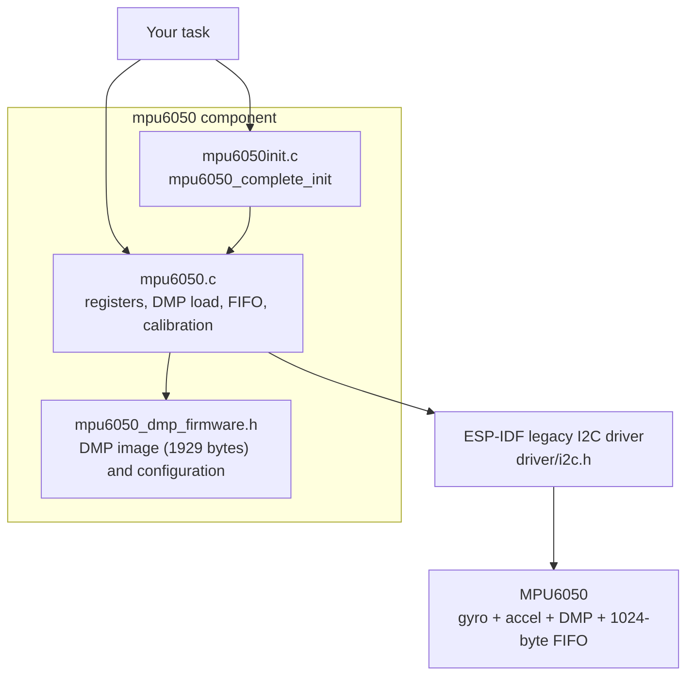
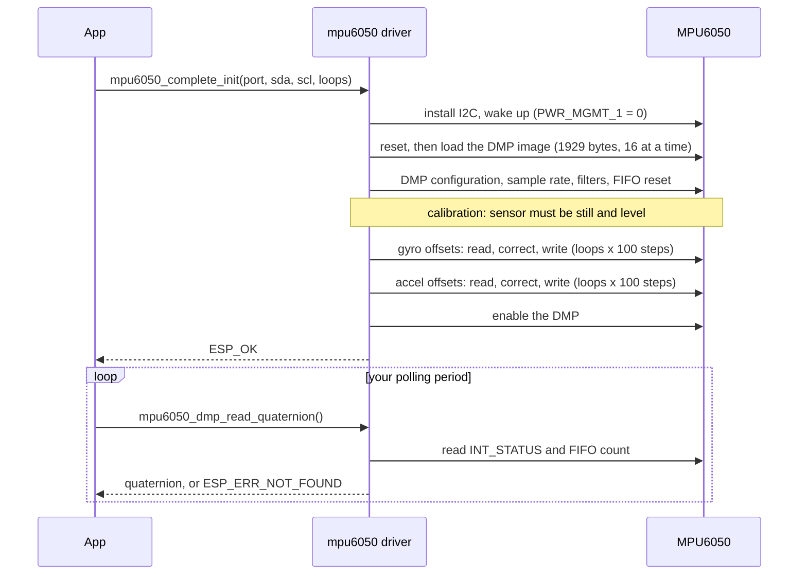
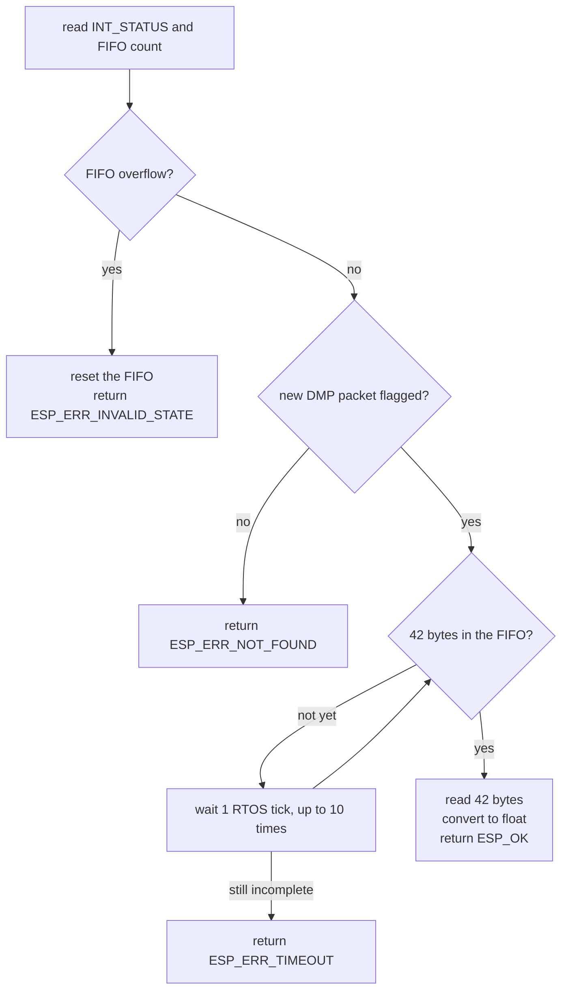

# mpu6050 component

Driver for the **MPU6050** inertial sensor (3-axis gyroscope and 3-axis accelerometer) on ESP-IDF, over I2C. It reads raw measurements and, through the sensor's on-chip **DMP** (Digital Motion Processor), the orientation of the board as a quaternion.

Developed for ESP-IDF v5.3 on an ESP32-S3 (the Juca robot). It has no dependency on other components of this repository.

**Contents**

1. [What it does (and does not)](#1-what-it-does-and-does-not)
2. [Architecture](#2-architecture)
3. [Quick start](#3-quick-start)
4. [Wiring](#4-wiring)
5. [API reference](#5-api-reference)
6. [How it works](#6-how-it-works)
   - [6.1 Bring-up sequence](#61-bring-up-sequence)
   - [6.2 The DMP and its FIFO](#62-the-dmp-and-its-fifo)
   - [6.3 Reading a quaternion](#63-reading-a-quaternion)
   - [6.4 Calibration](#64-calibration)
   - [6.5 Sensor settings](#65-sensor-settings)
7. [Error codes](#7-error-codes)
8. [Reading the logs](#8-reading-the-logs)
9. [Limitations and gotchas](#9-limitations-and-gotchas)
10. [Files](#10-files)

---

## 1. What it does (and does not)

| It does | It does not |
|---|---|
| Install the I2C driver and wake the sensor | Share the I2C bus: it installs the driver itself, for one device |
| Read raw accelerometer and gyroscope values | Convert raw values to g or degrees per second |
| Load the DMP firmware and read the orientation quaternion from its FIFO | Give an absolute heading: there is no magnetometer, so yaw drifts slowly |
| Calibrate the gyroscope and accelerometer offsets (sensor still and level) | Store the calibration: the offsets are lost at power-off |
| Bring everything up in one call (`mpu6050_complete_init`) | Support the address 0x69 (AD0 high) or two sensors without editing `MPU6050_ADDR` |
| | Offer a `deinit`: the I2C driver stays installed |

The component knows nothing about the board: the I2C port and the pins are arguments.

---

## 2. Architecture



- Two layers. `mpu6050.c` is the driver, one function per operation. `mpu6050init.c` is a convenience that calls them in the right order.
- The driver uses the **legacy** ESP-IDF I2C API (`driver/i2c.h`). At boot ESP-IDF prints a warning that this driver is old; it is expected. Do not use the new I2C driver (`driver/i2c_master.h`) anywhere else in the same firmware: ESP-IDF aborts at start-up when both are linked.
- Component dependencies (`CMakeLists.txt`): `driver`, `log`.

---

## 3. Quick start

```c
#include "mpu6050.h"
#include "mpu6050init.h"
#include "esp_log.h"

static const char *TAG = "app";

void imu_demo(void)
{
    /* 1. I2C, DMP, calibration and DMP enable. The pins below are the Juca robot's.
     *    Keep the sensor STILL and LEVEL during this call (a few seconds). */
    ESP_ERROR_CHECK(mpu6050_complete_init(I2C_NUM_0, GPIO_NUM_40, GPIO_NUM_39, 15));

    /* 2. Poll for new quaternions. */
    mpu6050_quaternion_t q;
    for (;;) {
        esp_err_t err = mpu6050_dmp_read_quaternion(I2C_NUM_0, &q);
        if (err == ESP_OK) {
            ESP_LOGI(TAG, "w=%.3f x=%.3f y=%.3f z=%.3f", q.w, q.x, q.y, q.z);
        } else if (err != ESP_ERR_NOT_FOUND) {   /* NOT_FOUND = nothing new yet, not an error */
            ESP_LOGW(TAG, "read failed: %s", esp_err_to_name(err));
        }
        vTaskDelay(pdMS_TO_TICKS(40));
    }
}
```

A complete, runnable version is the example task `imu_task.c`, described in `README_imu.md` next to it (in `main/test_tasks/` or `main/example_tasks/`, depending on your tree).

---

## 4. Wiring

| MPU6050 pin | Connects to | Note |
|---|---|---|
| VCC | 3.3 V | Most breakout boards (GY-521) also accept 5 V through their regulator |
| GND | Ground | |
| SDA, SCL | Two GPIOs | The driver enables the internal pull-ups; most breakout boards also have their own |
| AD0 | Ground, or left open on a GY-521 | Selects the address 0x68, the only one supported |
| INT | Not used | The driver polls the status register instead |

The bus runs at 100 kHz.

---

## 5. API reference

All functions take the I2C port as the first argument and return `esp_err_t`.

**Bring-up**

| Function | What it does | Notes |
|---|---|---|
| `mpu6050_complete_init(port, sda, scl, loops)` | Runs the four steps below in order | Blocks for a few seconds. Sensor still and level |
| `mpu6050_init(port, sda, scl)` | Installs the I2C driver (master, 100 kHz) and wakes the sensor | Uninstalls the driver if the sensor does not answer |
| `mpu6050_dmp_initialize(port)` | Resets the sensor, loads the DMP firmware and its configuration | After `mpu6050_init`, before `mpu6050_dmp_enable` |
| `mpu6050_calibrate_gyro(port, loops)` | Tunes the gyroscope offsets until the readings are zero | Sensor still. `loops` 1 to 255 |
| `mpu6050_calibrate_accel(port, loops)` | Tunes the accelerometer offsets to (0, 0, 1 g) | Sensor still **and level**, Z axis up |
| `mpu6050_dmp_enable(port, enabled)` | Starts or stops the DMP | |

**Reading**

| Function | What it does | Notes |
|---|---|---|
| `mpu6050_dmp_read_quaternion(port, &q)` | Reads one DMP packet and returns the quaternion | Returns `ESP_ERR_NOT_FOUND` when there is nothing new. See [6.3](#63-reading-a-quaternion) |
| `mpu6050_read_data(port, &data)` | Raw accelerometer and gyroscope values, six `int16_t` | Unit-less LSB; see [6.5](#65-sensor-settings) for the scales |

**Low level**

| Function | What it does |
|---|---|
| `mpu6050_write_register(port, reg, value)` | Writes one register |
| `mpu6050_read_registers(port, reg, buffer, len)` | Reads consecutive registers |
| `mpu6050_reset(port)` | Device reset through `PWR_MGMT_1` |
| `mpu6050_set_sleep_enabled(port, enabled)` | Enters or leaves sleep mode |

`mpu6050_quaternion_t` is `{ float w, x, y, z; }`, normalized (w is 1.0 and the others 0.0 for "no rotation since the DMP started"). `mpu6050_data_t` holds `accel_x/y/z` and `gyro_x/y/z`.

---

## 6. How it works

### 6.1 Bring-up sequence



The order matters: the calibration writes the offset registers that the DMP then uses, so it runs after the DMP firmware is loaded and before the DMP is enabled.

### 6.2 The DMP and its FIFO

The DMP is a small processor inside the MPU6050. The driver uploads a program to it (the image in `mpu6050_dmp_firmware.h`, derived from Jeff Rowberg's I2Cdevlib). From then on the sensor does the sensor fusion by itself and writes the result to a FIFO inside the chip.

| Item | Value |
|---|---|
| DMP packet | 42 bytes; the quaternion is in the first 16 |
| Packet rate | About 10 per second: 200 Hz sensor rate divided by 20, set by the last byte of the DMP configuration (0x13). From the configuration, not measured |
| FIFO size | 1024 bytes, 24 packets: about 2.4 s of data if nobody reads |

### 6.3 Reading a quaternion

`mpu6050_dmp_read_quaternion` reads **one** packet per call:



How fast to call it:

- **Faster than the DMP rate** (for example every 40 ms): no packet is lost; the calls in between return `ESP_ERR_NOT_FOUND`. This is the normal way to use it, and that return value is not an error.
- **Slower than the DMP rate:** packets pile up, each call returns the oldest one, and after about 2.4 s the FIFO overflows. The call then returns `ESP_ERR_INVALID_STATE` once and resets the FIFO.

Each of the four quaternion components is a signed 16-bit number scaled by 16384 (`w = raw / 16384.0`).

### 6.4 Calibration

Two sensors of the same model read slightly different values at rest. The calibration finds the offsets that make this sensor read zero rotation and exactly 1 g downwards, and writes them to the sensor's offset registers.

- It is a small PI control loop: read the axis, compute the error to the expected value (0, or 16384 for the accelerometer Z axis, which is 1 g), correct the offset, repeat. Each of the `loops` passes is 100 steps with smaller gains than the previous one.
- **The sensor must not move.** For the accelerometer it must also be **level, with the Z axis pointing up**: the routine assumes gravity is entirely on Z.
- If the readings are still far from the target at the end of a pass, the pass starts over, up to 20 times. After that the function gives up with `ESP_ERR_TIMEOUT` instead of blocking forever, which is what happens if the robot is being moved.
- The offsets live in the sensor's volatile registers. Calibrate after every power-up.

### 6.5 Sensor settings

Set by `mpu6050_dmp_initialize`. The DMP firmware expects them; do not change them while it runs.

| Setting | Value | Meaning for `mpu6050_read_data` |
|---|---|---|
| Gyroscope range | +/-2000 degrees/s | 16.4 LSB per degree/s |
| Accelerometer range | +/-2 g (reset default) | 16384 LSB per g |
| Digital low-pass filter | 42 Hz | |
| Sample rate | 200 Hz | |
| Clock source | Gyroscope Z reference | |

---

## 7. Error codes

| Function | Returns |
|---|---|
| `mpu6050_init` | I2C driver errors; the error of the first write if the sensor does not answer (usually `ESP_FAIL` for no acknowledge, or `ESP_ERR_TIMEOUT`) |
| `mpu6050_dmp_initialize` | I2C errors; `ESP_ERR_INVALID_SIZE` if the DMP image is corrupted |
| `mpu6050_calibrate_gyro`, `_accel` | `ESP_ERR_INVALID_ARG` if `loops` is 0; `ESP_ERR_TIMEOUT` if the readings never settled; I2C errors |
| `mpu6050_dmp_read_quaternion` | `ESP_ERR_NOT_FOUND` nothing new (normal); `ESP_ERR_INVALID_STATE` FIFO overflow, FIFO was reset; `ESP_ERR_TIMEOUT` incomplete packet; `ESP_ERR_INVALID_ARG` NULL pointer; I2C errors |
| `mpu6050_complete_init` | The first error of the steps above |
| Others | I2C errors |

Every I2C transaction has a 1 s timeout.

---

## 8. Reading the logs

Tags: `MPU6050` (driver), `mpu6050_init` (bring-up helper), and `i2c` (ESP-IDF).

| Message | Level | Meaning |
|---|---|---|
| `i2c: This driver is an old driver, please migrate...` | W | Printed by ESP-IDF at boot because the legacy I2C driver is linked. Expected |
| `Calibrating MPU6050... keep the sensor still and level!` | I | The calibration starts now |
| `Calibrating gyro with 15 loops` / `Calibrating accel with 15 loops` | I | One line per sensor |
| `Calibration complete!` | I | Offsets written; the DMP is enabled next |
| `Failed to wake up MPU6050` | E | The sensor did not answer: wiring, power, or address |
| `Calibration did not converge: is the sensor moving?` | E | The readings never settled; see [6.4](#64-calibration) |
| `Failed to write DMP memory block` / `Failed to write DMP config` | E | I2C error while loading the DMP |

---

## 9. Limitations and gotchas

- **Yaw drifts.** Without a magnetometer the rotation around the vertical axis is integrated from the gyroscope only. Roll and pitch are corrected by gravity and stay stable.
- **`ESP_ERR_NOT_FOUND` is normal.** Do not log it as a failure.
- **Poll at least a few times per second,** or the FIFO overflows.
- **The quaternion is relative** to the orientation the sensor had when the DMP was enabled.
- **Calibration needs a still, level robot** and is repeated at every boot.
- **One device, address 0x68,** and the component owns the I2C port: there is no `deinit`.
- **Legacy I2C driver.** It cannot coexist with the new one in the same firmware.
- **`mpu6050_complete_init` leaves the I2C driver installed** if a step after the first fails; a second call then fails at the driver install. Reset to retry.
- **Not validated on the robot in this revision.** The code builds with ESP-IDF v5.3.1 and v5.3.6; the limits added to the calibration and to the FIFO wait were not exercised on hardware.

---

## 10. Files

```
components/mpu6050/
  CMakeLists.txt                    REQUIRES driver, log
  include/mpu6050.h                 driver API, register map, types
  include/mpu6050init.h             mpu6050_complete_init
  include/mpu6050_dmp_firmware.h    DMP image and configuration (data only)
  mpu6050.c                         driver implementation
  mpu6050init.c                     bring-up helper
  README.md                         this file
```
