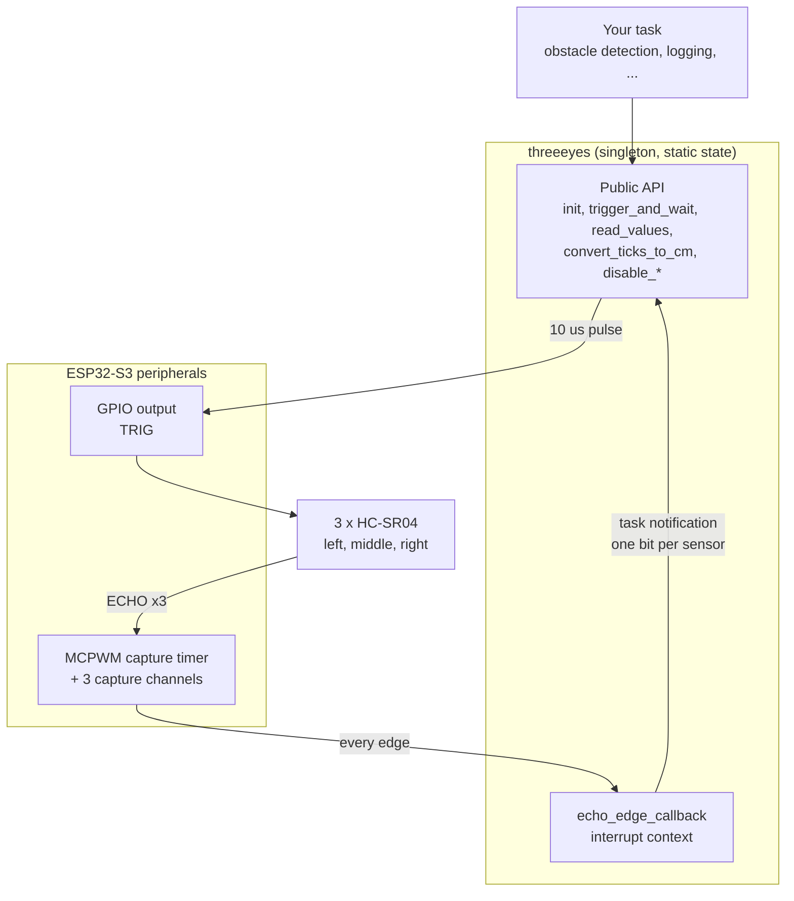
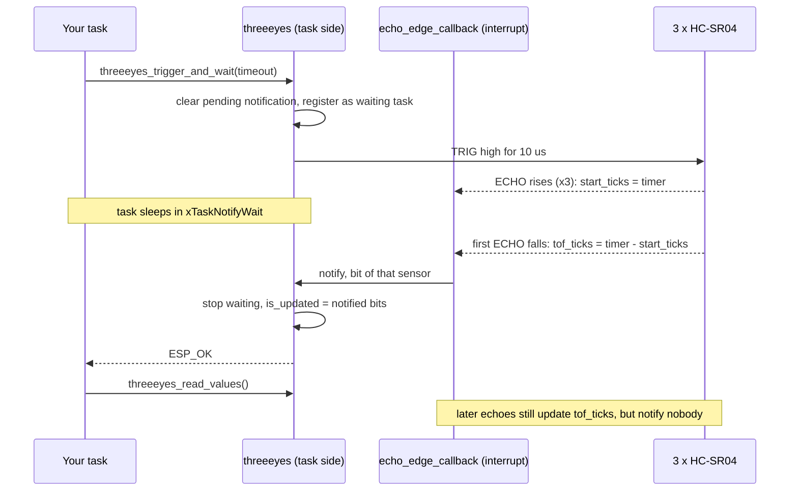

# threeeyes component

Driver for **three HC-SR04 ultrasonic sensors read in parallel** on ESP-IDF and FreeRTOS. The three sensors share one trigger pin and fire together; each echo pin is timed in hardware by an MCPWM capture channel. You ask for a measurement, the calling task sleeps until the first echo comes back, and you read the time of flight of each sensor.

Developed for ESP-IDF v5.3 on an ESP32-S3 (the Juca robot). It has no dependency on other components of this repository.

**Contents**

1. [What it does (and does not)](#1-what-it-does-and-does-not)
2. [Architecture](#2-architecture)
3. [Quick start](#3-quick-start)
4. [Wiring](#4-wiring)
5. [Configuration reference](#5-configuration-reference)
6. [API reference](#6-api-reference)
7. [How it works](#7-how-it-works)
   - [7.1 One measurement](#71-one-measurement)
   - [7.2 The first echo wins](#72-the-first-echo-wins)
   - [7.3 From ticks to centimeters](#73-from-ticks-to-centimeters)
   - [7.4 Nothing in range, and no echo at all](#74-nothing-in-range-and-no-echo-at-all)
   - [7.5 Task notification and concurrency](#75-task-notification-and-concurrency)
   - [7.6 Initialization and rollback](#76-initialization-and-rollback)
8. [Error codes](#8-error-codes)
9. [Reading the logs](#9-reading-the-logs)
10. [Limitations and gotchas](#10-limitations-and-gotchas)
11. [Files](#11-files)

---

## 1. What it does (and does not)

| It does | It does not |
|---|---|
| Fire the three sensors with one 10 us pulse on a shared trigger pin | Fire the sensors one at a time: they always fire together |
| Time each echo pulse in hardware (MCPWM capture, 12.5 ns per tick on the ESP32-S3) | Return the three distances of one trigger: the call returns at the **first** echo (see [7.2](#72-the-first-echo-wins)) |
| Put the calling task to sleep until the first echo, with a timeout | Filter, average or reject outliers: you get the raw echo width |
| Report, per sensor, whether its echo ended in time (`is_updated`) | Decide what "nothing in range" means: a long echo is returned as it is (see [7.4](#74-nothing-in-range-and-no-echo-at-all)) |
| Convert an echo width to centimeters | Compensate the speed of sound for temperature |
| Clean up after itself if initialization fails | Offer a `deinit`: the peripherals stay allocated until reset |

The component is a **singleton**: one set of three sensors. It knows nothing about the board; pins and the MCPWM group arrive in `threeeyes_config_t`.

---

## 2. Architecture



- The **task side** sends the trigger and sleeps. The **interrupt side** measures: it stores the timer value at the rising edge of each ECHO, computes the width at the falling edge, and wakes the task.
- The capture timer is a free-running 32-bit counter. It is independent of the PWM timers of the same MCPWM group, so the group that drives the motors can also be used here.
- Component dependencies (`CMakeLists.txt`): `esp_driver_mcpwm`, `esp_driver_gpio`, `log`.

---

## 3. Quick start

```c
#include "threeeyes.h"
#include "esp_log.h"

static const char *TAG = "app";

void sonar_demo(void)
{
    /* 1. Configure. The pins below are the Juca robot's; keep yours in your board header. */
    const threeeyes_config_t config = {
        .trig_gpio        = GPIO_NUM_42,   /* shared by the three sensors */
        .echo_left_gpio   = GPIO_NUM_5,
        .echo_middle_gpio = GPIO_NUM_4,
        .echo_right_gpio  = GPIO_NUM_1,
        .mcpwm_group_id   = 0,
    };
    ESP_ERROR_CHECK(threeeyes_init(&config));

    for (;;) {
        /* 2. Fire and sleep until the first echo. 60 ms covers a full HC-SR04 cycle. */
        esp_err_t err = threeeyes_trigger_and_wait(pdMS_TO_TICKS(60));
        if (err == ESP_ERR_TIMEOUT) {
            ESP_LOGW(TAG, "no echo: sensors unplugged or unpowered");
        } else {
            /* 3. Read, and use only the sensors marked as updated. */
            threeeyes_value_t left, middle, right;
            threeeyes_read_values(&left, &middle, &right);
            if (middle.is_updated) {
                ESP_LOGI(TAG, "middle: %.1f cm", threeeyes_convert_ticks_to_cm(middle.tof_ticks));
            }
        }

        /* 4. Let the echoes die out before the next trigger. */
        vTaskDelay(pdMS_TO_TICKS(100));
    }
}
```

A complete, runnable version is the example task `threeeyes_task.c`, described in `README_threeeyes.md` next to it (in `main/test_tasks/` or `main/example_tasks/`, depending on your tree).

---

## 4. Wiring

| HC-SR04 pin | Connects to | Note |
|---|---|---|
| VCC | 5 V | The sensor does not work at 3.3 V |
| GND | Ground, common with the ESP32-S3 | |
| TRIG (all three) | One GPIO output (`trig_gpio`) | A 3.3 V pulse is enough to trigger the sensor |
| ECHO (one per sensor) | One GPIO input each | **5 V output.** The ESP32-S3 inputs are 3.3 V: use a level shifter or a resistor divider on each line |

The echo inputs have no internal pull-up or pull-down. A sensor that is not connected leaves its pin floating.

---

## 5. Configuration reference

`threeeyes_config_t` is read once, by `threeeyes_init`. Every field is mandatory.

| Field | Type | Meaning |
|---|---|---|
| `trig_gpio` | `gpio_num_t` | Output pin wired to the TRIG input of all three sensors |
| `echo_left_gpio` | `gpio_num_t` | Input pin of the left sensor's ECHO |
| `echo_middle_gpio` | `gpio_num_t` | Input pin of the middle sensor's ECHO |
| `echo_right_gpio` | `gpio_num_t` | Input pin of the right sensor's ECHO |
| `mcpwm_group_id` | `int` | MCPWM group that provides the capture timer: 0 or 1 on the ESP32-S3 |

"Left", "middle" and "right" are only names for the three channels: the component does not know where each sensor is mounted.

**No Kconfig.** The component has no `menuconfig` menu. Keep the pins of your robot in your application (the Juca project keeps them in `main/juca_board.h` as `JUCA_PIN_HCSR04_*` and `JUCA_MCPWM_GROUP_HCSR04`) and fill the struct from them.

---

## 6. API reference

| Function | What it does | Notes |
|---|---|---|
| `threeeyes_init(&config)` | Creates the capture timer and the three channels, configures TRIG, starts the timer | Call once. Releases everything if a step fails |
| `threeeyes_trigger_and_wait(timeout_ticks)` | Fires the sensors and blocks until the first echo ends, or the timeout | Blocks the caller. One task only. See [7.2](#72-the-first-echo-wins) |
| `threeeyes_read_values(&left, &middle, &right)` | Copies the result of the last trigger for the three sensors | All three pointers are required |
| `threeeyes_convert_ticks_to_cm(tof_ticks)` | Echo width in ticks to distance in cm | Returns 0.0 before `init` |
| `threeeyes_disable_left()`, `_middle()`, `_right()` | Stops capturing one sensor's echo | That sensor then never reports `is_updated`. There is no re-enable |

`threeeyes_value_t`:

| Field | Type | Meaning |
|---|---|---|
| `tof_ticks` | `uint32_t` | Width of the last echo pulse, in capture timer ticks. Only meaningful when `is_updated` is true |
| `is_updated` | `bool` | true if this sensor's echo ended before `threeeyes_trigger_and_wait` returned |

One constant: `THREEEYES_US_PER_CM` (58.0), the round-trip time of sound per centimeter.

---

## 7. How it works

### 7.1 One measurement



The trigger pulse is a 10 us busy-wait (`esp_rom_delay_us`): far too short for an RTOS delay, and short enough not to matter.

### 7.2 The first echo wins

`threeeyes_trigger_and_wait` returns as soon as **one** sensor finishes its echo. That is the sensor with the nearest object, because a shorter distance means a shorter echo.

| Situation | What `read_values` reports |
|---|---|
| Object at 15 cm in front of the middle sensor, 60 cm in front of the left | middle: `is_updated = true`, 15 cm. left and right: `is_updated = false` |
| Two sensors see the same object at almost the same distance | Both may be `true`, if the second echo ends before the task wakes up |
| Nothing in range anywhere | The three long echoes end together: usually all `true`, each about 650 cm |

So one call answers "what is the nearest thing, and on which side". It does **not** give three independent distances. If you need one specific sensor, disable the other two; then the first echo is always that sensor's.

### 7.3 From ticks to centimeters

```
tof_us      = tof_ticks * 1 000 000 / timer_resolution_hz
distance_cm = tof_us / THREEEYES_US_PER_CM
```

- The timer resolution is read from the MCPWM driver at `init`. On the ESP32-S3 the capture timer runs on the 80 MHz APB clock, so one tick is 12.5 ns.
- Sound travels at about 343 m/s in air at 20 degrees C. One centimeter there and back is 2 cm / 34 300 cm/s = 58.3 us; the HC-SR04 datasheet rounds it to 58.
- The speed of sound changes by about 0.17% per degree C. The component does not correct for it: at 30 degrees C a real 100 cm reads about 98 cm.

| Echo width | `tof_ticks` at 80 MHz | Distance |
|---|---|---|
| 580 us | 46 400 | 10 cm |
| 1.16 ms | 92 800 | 20 cm |
| 5.8 ms | 464 000 | 100 cm |
| 23.2 ms | 1 856 000 | 400 cm (maximum range of the sensor) |
| about 38 ms | about 3 040 000 | about 650 cm: "nothing in range" |

### 7.4 Nothing in range, and no echo at all

These are two different cases, and the component reports them differently:

| Case | What the sensor does | What you get |
|---|---|---|
| **Nothing in range** | Lowers ECHO by itself after about 38 ms | `ESP_OK`, `is_updated = true`, about 650 cm. Treat any distance above 400 cm as "no object" |
| **No echo at all** (sensor unplugged, no 5 V) | ECHO never moves | `ESP_ERR_TIMEOUT`, and **all** `is_updated` flags are false |

Because a free field still answers after about 38 ms, a timeout of 60 ms only expires when no sensor answers. A timeout shorter than 38 ms turns an empty room into `ESP_ERR_TIMEOUT`.

### 7.5 Task notification and concurrency

The interrupt wakes the task with a **direct-to-task notification** (index 0), setting bit 0, 1 or 2 for the left, middle or right sensor.

- **One task only.** The component stores the handle of the task that is waiting. Two tasks calling `threeeyes_trigger_and_wait` at the same time would overwrite each other.
- **Your task's notification is used.** Before each trigger the component clears the pending state and the value of notification index 0 of the calling task. Do not use that notification for something else in the same task.
- **Late echoes do not leak into the next call.** The interrupt only notifies while a task is registered as waiting, and the registration ends as soon as the wait returns. A notification that still arrives in between is discarded at the start of the next call. Without that, the next wait would return at once with no sensor updated.
- **Shared data.** `start_ticks` and `tof_ticks` are single 32-bit words written by the interrupt and read by the task; a 32-bit read is atomic on the ESP32-S3, so no lock is needed. The `is_updated` flags are written by the task only.
- **Timer wrap-around.** The 32-bit timer wraps every 53.7 s at 80 MHz. The width is an unsigned subtraction, so it stays correct across a wrap.

### 7.6 Initialization and rollback

`threeeyes_init` does, in order:

1. creates the capture timer in `mcpwm_group_id` and reads its resolution;
2. for each sensor: creates a capture channel on both edges, registers the edge callback, enables the channel (the callback must be registered before the channel is enabled);
3. configures the trigger pin as an output, at low level;
4. enables and starts the capture timer.

If any step fails, the channels and the timer created so far are disabled and deleted, and the error of the failing driver call is returned. Nothing stays allocated, so `threeeyes_init` can be called again.

A second call after a successful one returns `ESP_ERR_INVALID_STATE`.

---

## 8. Error codes

| Function | `ESP_ERR_INVALID_STATE` | `ESP_ERR_INVALID_ARG` | Others |
|---|---|---|---|
| `init` | already initialized | NULL config | errors of the MCPWM or GPIO driver, for example `ESP_ERR_NOT_FOUND` when the capture timer of that group is already taken |
| `trigger_and_wait` | not initialized | | `ESP_ERR_TIMEOUT`: no echo before the timeout |
| `read_values` | | a NULL output pointer | |
| `disable_left`, `_middle`, `_right` | not initialized, or that sensor is already disabled | | error of the MCPWM driver |

`threeeyes_convert_ticks_to_cm` returns a `float` and cannot fail; before `init` it returns 0.0.

---

## 9. Reading the logs

All messages use the tag `threeeyes`.

| Message | Level | Meaning |
|---|---|---|
| `Initialized (capture timer at 80000000 Hz).` | I | `init` finished. The number is the timer resolution used for the conversion |
| `Failed to create the capture timer` | E | The MCPWM group is invalid, or its capture timer is already in use |
| `Failed to create the capture channel of sensor N` | E | Invalid echo pin for sensor N (0 left, 1 middle, 2 right) |
| `Failed to configure the trigger pin` | E | Invalid trigger pin |
| `Already initialized` | E | `init` was called twice |
| `Not initialized` | E | A measurement or disable function was called before `init` |
| `Sensor N is already disabled` | E | `disable_*` was called twice for the same sensor |

A timeout is **not** logged by the component: it is a normal return value, and the caller decides whether it is worth a message.

---

## 10. Limitations and gotchas

- **First echo only.** One trigger gives the nearest sensor, not three distances (see [7.2](#72-the-first-echo-wins)).
- **The sensors hear each other.** They fire together, so one sensor can receive the echo of another's burst. The side readings depend on how the sensors are angled.
- **Wait between triggers.** The HC-SR04 needs about 60 ms per cycle. A trigger sent while an echo of the previous one is still in flight gives a wrong or missing reading.
- **`tof_ticks` is not cleared.** A sensor with `is_updated == false` still holds the width of an older echo. Always check the flag first.
- **About 650 cm means "nothing".** Check the distance against the 400 cm range of the sensor before using it.
- **Blocking call.** `threeeyes_trigger_and_wait` can block for up to the timeout (about 38 ms in a free field). Account for it in the period of the calling loop.
- **One task, and its notification index 0.** See [7.5](#75-task-notification-and-concurrency).
- **One instance, no deinit.** The state is static, and the capture timer of the chosen MCPWM group stays taken until reset.
- **Disable is one-way.** A disabled sensor cannot be enabled again without a reset.
- **Not validated in a test rig.** The code builds with ESP-IDF v5.3.1 and v5.3.6; there is no host test for this component.

---

## 11. Files

```
components/threeeyes/
  CMakeLists.txt          REQUIRES esp_driver_mcpwm, esp_driver_gpio, log
  include/threeeyes.h     public API, types, constants
  threeeyes.c             implementation, static singleton state
  README.md               this file
```

Inside `threeeyes.c`, in order: private types and static state; `echo_edge_callback` (the interrupt side); helpers (`release_resources`, `disable_sensor`); the public API (`init`, `trigger_and_wait`, `read_values`, `convert_ticks_to_cm`, the three `disable_*`).
