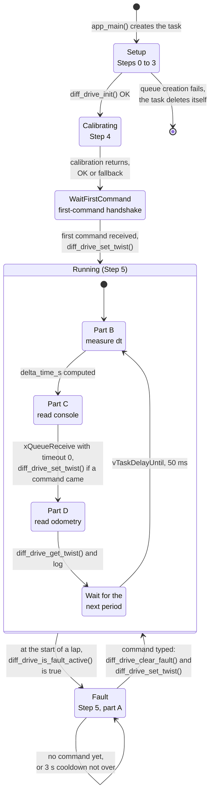
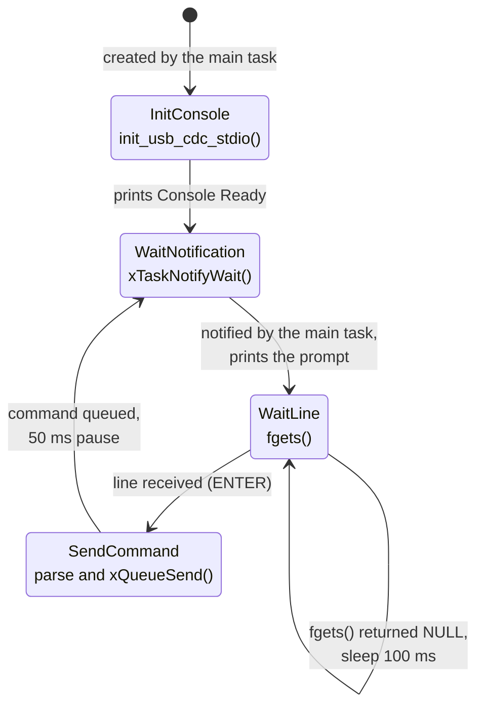

# Differential drive task

Example that drives the Juca robot with the `diff_drive` component. You type a velocity command in the serial monitor, the robot follows it, and the task logs the velocity the robot **really** has, measured by the wheel encoders.

- Source: [`diff_drive_task.c`](diff_drive_task.c). It is written as a step-by-step tutorial, with comments on every block; read it side by side with this page.
- Back to the [list of tasks](README.md).

## What you get out of it

- The full start-up sequence of the component: shared ADC, two wheels, `diff_drive_init()`, automatic calibration.
- Commanding the robot with a **twist** (`linear_x` in m/s, `angular_z` in rad/s), the same convention as a ROS `Twist`.
- **Odometry**: how to read back the velocity the robot is actually doing, and how it compares with what you asked.
- The **overcurrent protection**: what happens when a wheel stalls, and how to recover.

## Before you run it

The robot **moves by itself** during the calibration, and then follows every command you type.

- Put the robot **on a stand with the wheels in the air**, or on the floor with **at least 2 m of free path** in front of it.
- Make sure the **motor supply** (battery) is on.
- The first time, be ready to cut the motor power.
- During the 4 s calibration the overcurrent protection is paused, so a blocked wheel would not be detected.

## How to run

1. In [`main/main.c`](../main.c), enable only this task: comment out the other `#define` lines (for example `IMU_TASK`) and remove the `//` from `DIFF_DRIVE_TASK`. Do **not** enable `WHEEL_CTRL_TASK` together with it, because both take the same motors and encoders.
2. Build, flash and open the monitor: `idf.py build flash monitor`.
3. Wait for the calibration to finish. The prompt `Enter target velocity (linear_x angular_z):` only appears afterwards.
4. Type a command and press ENTER.

## Commands

A command is two numbers separated by a space: `<linear_x> <angular_z>`.

| You type | The robot |
|---|---|
| `0.2 0` | goes forward at 0.2 m/s |
| `-0.2 0` | goes backward at 0.2 m/s |
| `0 1` | spins in place, counter-clockwise (to the left), at 1 rad/s |
| `0 -1` | spins in place, clockwise (to the right), at 1 rad/s |
| `0.3 0.5` | goes forward at 0.3 m/s while turning left (a curve) |
| `0 0` | stops |

A line that is not two valid numbers (text, a missing value, `nan`, `inf`) is **not** guessed: the task answers `Invalid input!` and sends `0 0`, so the robot stops.

## How the code works: a state machine

The task is easiest to understand as a **state machine**: at any moment it is in exactly one *state*, and it only moves to another state when a specific *event* happens. The source has no `state` variable and no `switch`; the state is given by **where the execution is** inside `diff_drive_ctrl_task()`. The order of the lines is the sequence of states, and the `for ( ; ; )` loop at the end holds the two states that repeat. In the diagram, `●` is where the task starts, `◉` is where it ends, each box is a state and each arrow is a transition, labelled with the event that triggers it (and the call that handles it).

To find a state in the source, search for the markers in the comments: `Step 0` to `Step 5`, and `Part A` to `Part D` inside the loop.

### The main task



A normal session walks the diagram from top to bottom: `Setup`, `Calibrating`, `WaitFirstCommand`, and then the task stays in `Running`, going around its four inner states every 50 ms. `Fault` is only visited if the overcurrent protection trips.

### The states, one by one

#### Setup (Steps 0 to 3)

Nothing moves. The task prepares everything it needs:

- **Step 0:** creates `s_command_queue`, the mailbox that carries commands from the console task, and starts the console task. If the queue cannot be created, it logs `Failed to create command queue!` and the task deletes itself. This is the only way out of the diagram (a failure in `ESP_ERROR_CHECK`, below, aborts the whole program instead).
- **Step 1:** creates the ADC unit shared by both current sensors (`adc_oneshot_new_unit()` and one `adc_oneshot_config_channel()` per wheel).
- **Step 2:** fills in the two `wheel_config_t` and calls `wheel_create()`. The motors start braked.
- **Step 3:** fills in `diff_drive_config_t` and calls `diff_drive_init()`, which validates it and starts the library's own control and safety tasks. From here the robot is armed, but stopped.

Any error in Steps 1 to 3 is caught by `ESP_ERROR_CHECK`, which stops the program with an error message; for that reason these failures have no state of their own. **Leaves when** `diff_drive_init()` returns OK. **Log:** `Wheel instances created successfully.`

#### Calibrating (Step 4)

The robot **moves**. The task logs a warning, waits 2 s so you can step away (`vTaskDelay`), and calls `diff_drive_calibrate_max_speed(4000, &measured_max_rad_s)`, which blocks for 4 s while both wheels spin and the encoders measure them. The safety task is paused during this call.

Both outcomes lead to the same next state, so the diagram has a single arrow: if the call returns `ESP_OK`, the task logs `Auto-calibration successful!`; otherwise it logs `Calibration skipped or failed (...)` and continues with the configuration estimates. **Leaves when** the call returns.

#### WaitFirstCommand

The robot stands still while the task waits for you. This is the first use of the **handshake** with the console task (see below):

1. `xTaskNotify()` tells the console task to print its prompt.
2. `xQueueReceive(..., portMAX_DELAY)` blocks, with no timeout, until a command arrives in the queue.
3. `diff_drive_set_twist()` registers it as the target, and `xTaskNotify()` asks the console for the next command.

**Leaves when** the first command has been received and applied. **Log:** the prompt, `Accepted target -> ...`, `First valid command applied ...` and `Application loop (odometry + telemetry) running at 20 Hz...`.

#### Running (Step 5, normal lap)

The robot follows the last command it received. The task runs the loop every 50 ms (20 Hz) and, in each lap, passes through four inner states:

- **Part B, measure dt.** Computes `delta_time_s`, the real time since the previous lap, from the tick counter. The odometry needs the real elapsed time, not the nominal 50 ms.
- **Part C, read console.** `xQueueReceive(s_command_queue, ..., 0)`. The timeout is **0**, so it never waits: if you did not type anything, the lap continues. If a command is there, `diff_drive_set_twist()` registers it and `xTaskNotify()` asks the console for the next one.
- **Part D, read odometry.** `diff_drive_get_twist(delta_time_s, &estimated_twist)` returns the velocity measured by the encoders, and the task logs the `[Odometry]` line.
- **Wait for the next period.** `vTaskDelayUntil()` sleeps until the next 50 ms boundary. Unlike a plain `vTaskDelay()`, it does not add the time spent working, so the rate stays at 20 Hz.

Two details help to read this state correctly:

- **"Stopped" is not a state of this task.** `0 0` is just another command received in Part C. The robot slows down to a stop through the library's acceleration ramp, while the task stays in `Running`.
- **The motion itself is not here.** The ramp, the kinematics and the PWM are done by the library's control task (every 20 ms). This task only says where to go (`diff_drive_set_twist()`) and reads how fast the robot really goes (`diff_drive_get_twist()`).

**Leaves when**, at the start of a lap, `diff_drive_is_fault_active()` is true.

#### Fault (Step 5, part A)

The overcurrent protection tripped and the library braked both wheels. **Who causes this transition is not in this file:** the library's safety task latches the fault, and `diff_drive_ctrl_task()` finds out by polling `diff_drive_is_fault_active()` at the start of every lap, so it notices within one period (50 ms). The log shows `OVERCURRENT DETECTED! ... Emergency brake activated!`.

While the fault is active, each lap does only this (it is the `if` at the top of the loop, and it ends with `continue`, which skips Parts B, C and D):

1. If at least 3 s passed since the last attempt, it notifies the console and checks the queue without waiting.
2. If a command is there, it calls `diff_drive_clear_fault()`, then `diff_drive_set_twist()` with that command, and records the time of the attempt. Clearing the fault does **not** resume the old motion; the new command is what makes the robot move.
3. It resets `previous_tick`, so the time spent in `Fault` is not counted as elapsed time by the next odometry reading, and sleeps until the next period.

If there is no command, or the cooldown is not over, nothing changes: that is the arrow from `Fault` to itself. A command typed during the cooldown waits in the queue until it is over. **Leaves when** a command is applied; the next lap finds the fault cleared and goes back to `Running`. No `[Odometry]` lines are printed while in `Fault`. **Log:** `Safety lock active! Cleared fault and re-issued target twist.` (or `Resume command rejected (...)` if the library refuses the command).

### The console task

Reading the keyboard blocks (`fgets()` does not return until you press ENTER), so it lives in its own low-priority task, and waiting for you never delays the 20 Hz loop. It is also a small state machine:



The two tasks talk through two channels, one in each direction:

| Direction | Mechanism | Meaning |
|---|---|---|
| Main task to console | `xTaskNotify()` | "I am ready, ask the user for a command." |
| Console to main task | `s_command_queue` | "Here is the command the user typed." |

The console only prompts when notified, which is why the prompt never shows up in the middle of the calibration logs. The main task notifies it in three places: in `WaitFirstCommand`, in `Running` after each command it applies, and in `Fault` at each recovery attempt. In `SendCommand`, a line that does not parse is turned into `0 0` (stop) before being queued; an end-of-file or read error queues nothing and the task keeps waiting for a line.

### Typical log

Abridged. The calibration values (trim factors and 26.17 rad/s) come from one real run of the Juca and yours will differ a little; the odometry values are only illustrative.

```
diff_drive_task: Wheel instances created successfully.
diff_drive: Differential drive module initialized successfully.
diff_drive_task: Starting calibration. Ensure robot path is clear!
diff_drive: Starting maximum speed auto-calibration pulse (4000 ms at 350 of 400 duty ticks)...
diff_drive: Measured uncompensated wheel speeds at test duty -> Left: ... rad/s, Right: ... rad/s
diff_drive: Calibration completed. Trim Factors -> Left: 1.000, Right: 0.967 | Calibrated Speed at 100% duty: 26.17 rad/s
diff_drive_task: Auto-calibration successful! Max wheel speed: 26.17 rad/s
Enter target velocity (linear_x angular_z):
0.2 0                                                  <- you type this
Accepted target -> linear_x = 0.20, angular_z = 0.00
diff_drive_task: First valid command applied (Linear=0.200, Angular=0.000). ...
diff_drive_task: [Odometry] Linear X: 0.187 m/s | Angular Z: 0.012 rad/s
```

If the calibration fails (for example, a wheel did not turn), the task logs `Calibration skipped or failed (...)` and goes on with the estimates from the configuration and no trim. It still works, but the robot may drift to one side.

## How to read the results

- **The speed does not jump.** The component limits the acceleration (0.5 m/s² linear, 1.5 rad/s² angular in this example), so `0.2 0` takes about 0.4 s to reach 0.2 m/s. The odometry shows that ramp.
- **Measured is not always equal to commanded.** The control is **open loop**: the component converts your speed into motor power but does not correct it using the encoders. At low speeds the motors may barely turn (dead zone), and the result also changes with the battery charge and the floor. Compare the `[Odometry]` line with what you typed; this difference is the point of the exercise.
- **Very large commands are scaled down.** The wheels cannot go faster than a limit, so a command outside it keeps its direction and curvature but is reduced to the edge of what is reachable. With the calibration above, the rule of thumb is `|linear_x| + 0.15 * |angular_z|` up to about 0.69 m/s (the 0.15 is the half track width in meters). Before or without a calibration the limit is lower, about 0.52 m/s. On top of that the example limits the commands to 0.8 m/s and 2.0 rad/s.
- **Going straight.** The calibration gives the faster wheel a trim factor below 1, so equal commands to both wheels should drive straight. A strong drift usually means the calibration failed or the floor was very different.

## If the robot stalls (overcurrent protection)

If the current of a wheel stays above the threshold (raw ADC value 3000, which is about 0.8 A with the Juca conversion factor), the safety task:

1. Brakes both wheels and discards the current target. The log shows `OVERCURRENT DETECTED! ... Emergency brake activated!`.
2. Refuses new motion commands until the fault is cleared.

To recover, free the robot and **type a new command**. The task clears the fault and applies that command (`Safety lock active! Cleared fault and re-issued target twist.`). Recovery attempts are at least 3 s apart, so the command can wait up to 3 s before being picked up.

## Parameters worth changing

All of them are in the `drive_config` structure of `diff_drive_ctrl_task()`.

| Field | Value in the example | What it does |
|---|---|---|
| `max_linear_velocity_m_s` | 0.8 | Upper limit for `linear_x` (0 disables it) |
| `max_angular_velocity_rad_s` | 2.0 | Upper limit for `angular_z` (0 disables it) |
| `max_accel_linear_m_s2` | 0.5 | Linear acceleration ramp (0 or less disables it) |
| `max_accel_angular_rad_s2` | 1.5 | Angular acceleration ramp (0 or less disables it) |
| `max_adc_raw_threshold` | 3000 | Overcurrent threshold, in raw ADC counts (0 disables the protection) |
| `control_period_ms` | 20 | Period of the library control task |
| `monitor_period_ms` | 50 | Period of the library safety task |
| `diff_drive_calibrate_max_speed(4000, ...)` | 4000 ms | Duration of the calibration pulse (0.5 s to 10 s) |

The physical constants of the robot (track width, wheel radius, encoder counts per turn, motor power cap and current conversion factor) are **not** here: they live in [`juca_board.h`](../juca_board.h) and are shared by all tasks.

## Troubleshooting

| Symptom | Likely cause |
|---|---|
| No prompt after the start-up logs | The calibration is still running; the prompt appears only after the calibration messages |
| The robot does not move | Motor supply off; the command is too small for the motors to start; or a fault is active (look for `OVERCURRENT DETECTED!`) |
| `Calibration failed: Zero encoder ticks detected` | A wheel did not turn: motor unplugged, jammed, or encoder wiring |
| The robot drifts to one side | Calibration failed or was skipped; run it again on a flat, clear floor |
| `Invalid input!` | The line was not two numbers separated by a space |
| The log scrolls while you type | The odometry is printed at 20 Hz; keep typing, the command is read when you press ENTER |
