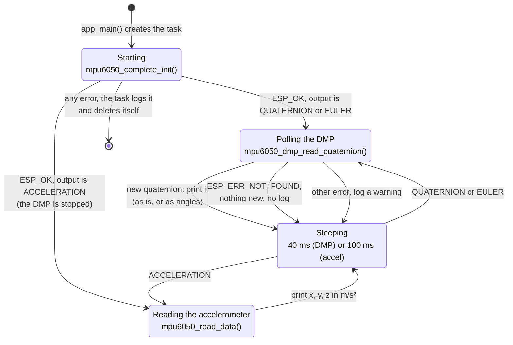

# IMU task

Example that reads the MPU6050 inertial sensor of the Juca robot with the `mpu6050` component. Depending on one macro, it prints the **orientation quaternion**, the **roll, pitch and yaw angles**, or the **acceleration** of the robot. Nothing moves.

- Source: [`imu_task.c`](imu_task.c). Component: [`components/mpu6050`](../../components/mpu6050) ([README](../../components/mpu6050/README.md)).
- Back to the [list of tasks](README.md).

## What you get out of it

- The start-up of the sensor in one call: I2C, DMP firmware, calibration, DMP enable.
- How to poll the DMP for new orientation data, and which return value means "nothing new yet".
- How to turn a quaternion into angles you can read, and raw accelerometer counts into m/s².
- What each of the three outputs looks like when you move the robot.

## Before you run it

- Put the robot on a **flat, level surface** and **do not touch it** until the log says `Calibration complete!`. The calibration assumes the sensor is still and that gravity points straight down through its Z axis.
- The I2C port and pins come from [`juca_board.h`](../juca_board.h):

| Signal | Constant | Value |
|---|---|---|
| I2C port | `JUCA_I2C_PORT_IMU` | `I2C_NUM_0` |
| SDA | `JUCA_PIN_I2C_SDA` | GPIO 40 |
| SCL | `JUCA_PIN_I2C_SCL` | GPIO 39 |

## How to run

1. In [`main/main.c`](../main.c), enable only this task: remove the `//` from `#define IMU_TASK` and comment out the others.
2. Choose the output (next section).
3. Build, flash and open the monitor: `idf.py build flash monitor`.
4. Wait for the calibration (a few seconds), then turn or tilt the robot by hand and watch the numbers.

## Choosing the output

Near the top of [`imu_task.c`](imu_task.c):

```c
#define IMU_TASK_OUTPUT            IMU_OUTPUT_QUATERNION
```

Replace the value with one of the three below and rebuild. Only the code of the chosen output is compiled.

| `IMU_TASK_OUTPUT` | Prints | Comes from | Rate |
|---|---|---|---|
| `IMU_OUTPUT_QUATERNION` (default) | Orientation quaternion `w, x, y, z` | DMP | About 10 lines per second |
| `IMU_OUTPUT_EULER` | Roll, pitch and yaw, in degrees | DMP quaternion, converted in the task | About 10 lines per second |
| `IMU_OUTPUT_ACCELERATION` | Acceleration on x, y and z, in m/s² | Accelerometer registers (the DMP is stopped) | 10 lines per second (`ACCELERATION_PERIOD_MS`) |

Any other value stops the build with `IMU_TASK_OUTPUT must be IMU_OUTPUT_QUATERNION, IMU_OUTPUT_EULER or IMU_OUTPUT_ACCELERATION`.

The macro can also be set from the build, without editing the file. In [`main/CMakeLists.txt`](../CMakeLists.txt), after `idf_component_register(...)`:

```cmake
target_compile_definitions(${COMPONENT_LIB} PRIVATE IMU_TASK_OUTPUT=2)   # 1 quaternion, 2 angles, 3 acceleration
```

## How the code works: a state machine



- **Starting.** `mpu6050_complete_init()` installs the I2C driver, loads the DMP firmware into the sensor, calibrates the gyroscope and the accelerometer, and enables the DMP. It blocks until all of that is done. If the sensor does not answer, or the calibration cannot settle, the task logs the error and ends. This step is the same for the three outputs.
- **Polling the DMP** (quaternion and angles). The sensor produces about 10 quaternions per second, and the task asks every 40 ms. So roughly two out of three polls find nothing new: the driver returns `ESP_ERR_NOT_FOUND`, and the task says nothing. Polling faster than the sensor produces is what guarantees that no packet is missed.
- **Reading the accelerometer** (acceleration). The task stops the DMP, which this output does not use (its FIFO would fill up for nothing), and reads the accelerometer registers directly every 100 ms. The offsets written by the calibration stay active.

## Expected log

Derived from the source code; it was not captured from a run on the robot. The first lines are the same for every output:

```
i2c: This driver is an old driver, please migrate your application code to adapt `driver/i2c_master.h`
mpu6050_init: Calibrating MPU6050... keep the sensor still and level!
MPU6050: Calibrating gyro with 15 loops
MPU6050: Calibrating accel with 15 loops
mpu6050_init: Calibration complete!
```

The first line is an ESP-IDF warning about the I2C driver the component uses. It is expected.

Then, with `IMU_OUTPUT_QUATERNION`, after turning the robot 45 degrees to the left:

```
imu_task: Quat [w=1.000 x=0.000 y=0.000 z=0.000]
imu_task: Quat [w=0.924 x=0.000 y=0.000 z=0.383]
```

With `IMU_OUTPUT_EULER`, the same movement:

```
imu_task: Roll     0.0 deg | Pitch    0.0 deg | Yaw     0.0 deg
imu_task: Roll     0.0 deg | Pitch    0.0 deg | Yaw    45.0 deg
```

With `IMU_OUTPUT_ACCELERATION`, robot at rest on the table:

```
imu_task: Printing the acceleration in m/s^2 (it includes gravity: about +9.8 on the vertical axis at rest).
imu_task: Accel [x=  0.01 y= -0.02 z=  9.80] m/s^2
```

## How to read each output

### Quaternion

A quaternion `(w, x, y, z)` describes one rotation: "turn by an angle around an axis". You do not need the theory to check the sensor:

| What you do with the robot | What you should see |
|---|---|
| Leave it as it was during the calibration | `w` close to 1, `x`, `y`, `z` close to 0 |
| Turn it 45 degrees to the left, flat on the table | `w` about 0.92, `z` about 0.38, `x` and `y` close to 0 |
| Turn it 90 degrees to the left | `w` and `z` both about 0.71 |
| Tilt it forward or sideways | `x` or `y` move away from 0 |

For a rotation of angle `a` around the vertical axis, `w = cos(a/2)` and `z = sin(a/2)`. The four numbers always satisfy `w² + x² + y² + z² = 1`.

### Angles (roll, pitch, yaw)

The task converts the quaternion to three angles, in the aerospace convention (rotation order Z, then Y, then X):

| Angle | Rotation around | Range | On the robot |
|---|---|---|---|
| Roll | x axis | -180 to +180 degrees | Tilting to one side |
| Pitch | y axis | -90 to +90 degrees | Tilting nose up or down |
| Yaw | z axis (vertical) | -180 to +180 degrees | Heading on a flat floor; positive = turned to the left |

```
roll  = atan2( 2 (w x + y z), 1 - 2 (x² + y²) )
pitch = asin ( 2 (w y - z x) )
yaw   = atan2( 2 (w z + x y), 1 - 2 (y² + z²) )
```

| What you do with the robot | What you should see |
|---|---|
| Leave it as it was during the calibration | All three close to 0 |
| Turn it 90 degrees to the left, flat on the table | Yaw about +90, roll and pitch close to 0 |
| Keep turning past 180 degrees | Yaw jumps from +180 to -180: it is the same direction |
| Tilt it sideways or nose up | Roll or pitch move away from 0 |

Things to know:

- **Relative angles.** Zero is the orientation of the robot at the end of the calibration, not north and not the horizon.
- **Which axis is which, and the signs, depend on how the sensor is mounted** on the board. Find out by tilting the robot: if lifting the nose changes roll instead of pitch, the sensor is rotated 90 degrees.
- **Yaw drifts** slowly (a few degrees per minute is typical): the sensor has no compass. Roll and pitch are held by gravity and stay stable.
- **Near pitch = ±90 degrees** (robot standing on its tail) roll and yaw are not defined and jump. A robot on the floor never gets there.

### Acceleration

The accelerometer counts are converted to m/s²: the driver keeps the ±2 g range, where 1 g is 16384 counts, and 1 g is 9.80665 m/s².

**The reading includes gravity.** The accelerometer cannot tell gravity from motion, so a robot at rest reads about 9.8 m/s² on the vertical axis.

| What you do with the robot | What you should see |
|---|---|
| Leave it at rest, level | `z` about +9.8, `x` and `y` close to 0 |
| Tilt it 90 degrees to one side | 9.8 moves from `z` to `x` or `y` |
| Turn it upside down | `z` about -9.8 |
| Push it forward quickly on the table | `x` or `y` jumps for a moment, then goes back to 0 |
| Shake it | Values up to about ±19.6 (2 g), the limit of the range |

- The offsets written by the calibration make the robot read exactly (0, 0, +9.8) in the position it had during the calibration.
- The values are single readings, with no filter: expect a few hundredths of m/s² of noise at rest, and more when the motors run (vibration).
- To get only the acceleration of the motion, gravity must be subtracted using the orientation. This example does not do that.

## Parameters worth changing

At the top of [`imu_task.c`](imu_task.c).

| Constant | Value | What it does |
|---|---|---|
| `IMU_TASK_OUTPUT` | `IMU_OUTPUT_QUATERNION` | What is printed; see [Choosing the output](#choosing-the-output) |
| `CALIBRATION_LOOPS` | 15 | Calibration passes for each sensor. Fewer is faster and less accurate |
| `POLL_PERIOD_MS` | 40 | Quaternion and angles: how often the task asks the DMP. Keep it below 100 ms (the DMP period), or packets pile up in the sensor |
| `ACCELERATION_PERIOD_MS` | 100 | Acceleration: time between two readings. Any value works; below 20 ms the log cannot keep up |

## Checking the calibration

There are no thresholds to tune in this example; what can be checked is the quality of the calibration. The angles output is the easiest to read for this.

1. Set `IMU_TASK_OUTPUT` to `IMU_OUTPUT_EULER`. After `Calibration complete!`, leave the robot untouched for one minute.
2. Roll and pitch should stay within about 1 degree of zero. If they do not, the robot was not level or was moved during the calibration: reset and try again.
3. Yaw will creep slowly. That is the drift of a sensor without a compass and it is normal.
4. With `IMU_OUTPUT_ACCELERATION`, the robot at rest should read about (0, 0, +9.8). A large `x` or `y` at rest means the calibration was done with the robot tilted.

## Troubleshooting

| Symptom | Likely cause |
|---|---|
| `Failed to start the IMU: ESP_FAIL` right at boot, after `Failed to wake up MPU6050` | The sensor does not answer on I2C: SDA and SCL swapped, no power, or AD0 pulled high (address 0x69) |
| `Failed to start the IMU: ESP_ERR_TIMEOUT` after `Calibration did not converge` | The robot moved, or was not level, during the calibration |
| No `Quat` or `Roll` lines after the calibration | The DMP is not producing packets: reset the robot and watch for errors during start-up |
| `Failed to read DMP quaternion: ESP_ERR_INVALID_STATE` | FIFO overflow: the task is not polling often enough (something is blocking it, or `POLL_PERIOD_MS` is too long) |
| The numbers drift quickly while the robot is still | Bad calibration: repeat it on a level surface |
| Roll changes when you lift the nose (instead of pitch) | The sensor is mounted rotated: swap the names of the two axes in your reading |
| Acceleration at rest is not about 9.8 on one axis | Bad calibration, or the sensor range was changed by other code |
| Build error `IMU_TASK_OUTPUT must be ...` | The macro has a value other than the three outputs |
| The device restarts with `CONFLICT! driver_ng is not allowed to be used with this old driver` | Some other code in the firmware uses the new ESP-IDF I2C driver; the two cannot be mixed |