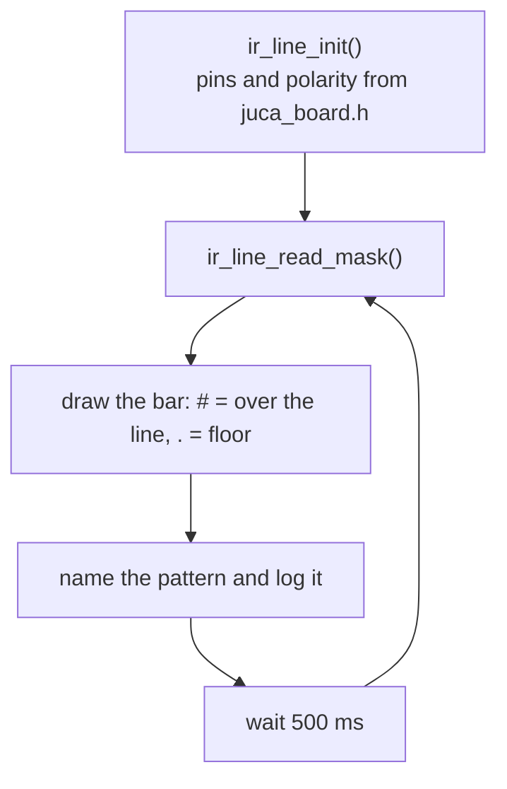

# Line sensors task

Example that reads the five infrared line sensors of the Juca robot with the `ir_line` component and prints where the line is. Nothing moves: you slide the robot over the line by hand.

- Source: [`ir_line_task.c`](ir_line_task.c). Component: [`components/ir_line`](../../components/ir_line) ([README](../../components/ir_line/README.md)).
- Back to the [list of tasks](README.md).

## What you get out of it

- A check that the five sensors work, are in the right order and have the right polarity. Do this before running any line follower.
- How to configure and read the component.

## Before you run it

Have a piece of the track at hand: the line the robot will follow, on the floor it will run on. The pins and the polarity come from [`juca_board.h`](../juca_board.h):

| Sensor (robot looking forward) | Constant | GPIO |
|---|---|---|
| Far left | `JUCA_PIN_IR_LINE_FAR_LEFT` | 15 |
| Left | `JUCA_PIN_IR_LINE_LEFT` | 16 |
| Middle | `JUCA_PIN_IR_LINE_MIDDLE` | 17 |
| Right | `JUCA_PIN_IR_LINE_RIGHT` | 18 |
| Far right | `JUCA_PIN_IR_LINE_FAR_RIGHT` | 8 |
| Level over the line | `JUCA_IR_LINE_LEVEL_ON_LINE` | 0 |

## How to run

1. In [`main/main.c`](../main.c), enable only this task: remove the `//` from `#define IR_LINE_TASK` and comment out the others.
2. Build, flash and open the monitor: `idf.py build flash monitor`.
3. Put the robot on the track and slide it sideways across the line.

## How the code works

The task has no state machine: it initializes the component once and then repeats the same three steps every 500 ms.



## Expected log

Derived from the source code; it was not captured from a run on the robot. The bar is drawn as the robot sees it, far left sensor first.

```
ir_line_task: [..#..] middle
ir_line_task: [.##..] left / middle
ir_line_task: [.#...] left
ir_line_task: [#....] far left
ir_line_task: [.....] no line
```

| Line in the log | Meaning |
|---|---|
| `[..#..] middle` | The line is under the middle sensor: the robot is centered |
| `[.##..] left / middle` | The line is between two sensors |
| `[.....] no line` | No sensor sees the line |
| `[#####] all sensors` | A crossing or a wide mark; also what a lifted robot shows with some sensors |
| `[#...#] other` | A combination a single line does not produce: check the sensors |

## Calibrating the sensors

Do the three checks in this order.

**1. Polarity.** Put the robot with all five sensors over the plain floor, away from the line.

- Expected: `[.....] no line`.
- If you see `[#####] all sensors` instead, the polarity is inverted: change `JUCA_IR_LINE_LEVEL_ON_LINE` in `juca_board.h` from 0 to 1 (or from 1 to 0) and flash again.

**2. Order.** Hold a strip of the line material under one sensor at a time, starting with the far left one:

- The far left sensor must light the **first** character of the bar, and the far right sensor the **last** one.
- If the bar is mirrored, reverse the order of the five `JUCA_PIN_IR_LINE_*` values. If two characters are swapped, swap those two pins.

**3. Threshold of each sensor.** Most digital modules have a trimmer and a small LED. For each sensor:

- Over the floor its character must be `.`, and over the line `#`, without flickering.
- If it never changes, or flickers, turn its trimmer slowly until it switches cleanly when the line passes under it. Do it at the height the bar has on the robot, on the real floor, under the real lighting: all three change the result.
- Slide the line across the whole bar and check that you get the nine patterns one after the other (`far left`, `left / far left`, `left`, ... `far right`) with no `no line` gap between two neighbours. A gap means the line is narrower than the space between two sensors: the follower will lose it there.

## Parameters worth changing

| Where | Constant | Value | What it does |
|---|---|---|---|
| [`ir_line_task.c`](ir_line_task.c) | `READ_PERIOD_MS` | 500 | Time between two readings. Lower it (for example 100) while adjusting the trimmers |
| [`juca_board.h`](../juca_board.h) | `JUCA_IR_LINE_LEVEL_ON_LINE` | 0 | Polarity, see check 1 |
| [`juca_board.h`](../juca_board.h) | `JUCA_PIN_IR_LINE_*` | | Pins and their order, see check 2 |

## Troubleshooting

| Symptom | Likely cause |
|---|---|
| `[#####]` on the floor and `[.....]` over the line | Inverted polarity (check 1) |
| The bar moves the wrong way | Pin order reversed (check 2) |
| One character never changes | That sensor's trimmer, its wiring, or its supply |
| Characters flicker | Trimmer close to the threshold, bar too high or too low, or strong ambient light |
| `Failed to initialize the line sensors` | A pin number in `juca_board.h` is not a valid GPIO |
