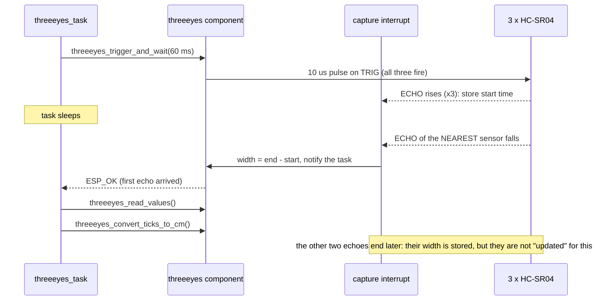

# Ultrasonic sensors task (ThreeEyes)

Example that reads the three HC-SR04 ultrasonic sensors of the Juca robot with the `threeeyes` component and prints the nearest obstacle. Nothing moves.

- Source: [`threeeyes_task.c`](threeeyes_task.c). Component: [`components/threeeyes`](../../components/threeeyes).
- Back to the [list of tasks](README.md).

## What you get out of it

- How to configure the component: four pins and one MCPWM group, taken from [`juca_board.h`](../juca_board.h).
- How one measurement works: trigger, wait, read, convert to centimeters.
- What the sensors answer when there is nothing in front of them, and when they are not connected.

## Before you run it

- The HC-SR04 is a **5 V** sensor. Its ECHO output is also 5 V, and the ESP32-S3 inputs are 3.3 V: there must be a level shifter or a resistor divider on each ECHO line.
- The three sensors share one trigger pin, so they always fire together.

| Signal | Constant in `juca_board.h` | GPIO |
|---|---|---|
| TRIG (shared) | `JUCA_PIN_HCSR04_TRIG` | 42 |
| ECHO left | `JUCA_PIN_HCSR04_ECHO_LEFT` | 5 |
| ECHO middle | `JUCA_PIN_HCSR04_ECHO_MIDDLE` | 4 |
| ECHO right | `JUCA_PIN_HCSR04_ECHO_RIGHT` | 1 |

## How to run

1. In [`main/main.c`](../main.c), enable only this task: remove the `//` from `#define THREE_EYES_TASK` and comment out the others.
2. Build, flash and open the monitor: `idf.py build flash monitor`.
3. Move your hand in front of each sensor and watch the log.

## How one measurement works



Three facts explain everything you will see in the log:

- **The call returns at the first echo.** That is the sensor with the nearest object. The other two are reported with `is_updated == false` for that trigger, even when they also see something farther away. To read one sensor alone, disable the other two with `threeeyes_disable_left()`, `_middle()` or `_right()`.
- **"Nothing in range" is still an answer.** With no object in front of it, the HC-SR04 lowers ECHO by itself after about 38 ms, which converts to about 650 cm. The task treats anything above 400 cm (the maximum range of the sensor) as `Nothing in range.`
- **The distance comes from time.** Sound takes about 58 us to travel 1 cm and come back, so `distance_cm = echo_width_us / 58`. The capture timer of the ESP32-S3 counts at 80 MHz, so one tick is 12.5 ns.

## Expected log

Derived from the source code; it was not captured from a run on the robot.

```
threeeyes: Initialized (capture timer at 80000000 Hz).
threeeyes_task: Nearest object: middle sensor, 23.4 cm
threeeyes_task: Nearest object: middle sensor, 23.5 cm
threeeyes_task: Nearest object: left sensor, 11.0 cm
threeeyes_task: Nothing in range.
```

With the sensors unplugged or without their 5 V supply, no echo ever arrives:

```
threeeyes_task: No echo within 60 ms: check the wiring and the 5 V supply of the sensors.
```

## Parameters worth changing

All of them are at the top of [`threeeyes_task.c`](threeeyes_task.c).

| Constant | Value | What it does |
|---|---|---|
| `ECHO_TIMEOUT_MS` | 60 | Longest wait for the first echo. Keep it above 38 ms, or a free field is reported as "no echo" |
| `MEASURE_PERIOD_MS` | 500 | Time between two measurements. Do not go below 60 ms: the echoes of one trigger must die out before the next |
| `MAX_RANGE_CM` | 400 | Distances above this are printed as "nothing in range" |

## Calibrating a distance threshold

To choose a threshold such as "obstacle at 20 cm" for your own application:

1. Put a flat object (a box, a book) at the distance you care about, measured with a ruler from the front of the sensor.
2. Read 10 lines of the log and note the lowest and the highest value.
3. Set the threshold a little above the highest value. Use two thresholds if the robot must react and then release (for example "obstacle" at 20 cm and "clear" at 35 cm), so that it does not flicker at the border.
4. Repeat with the object in front of the left and of the right sensor: the three sensors fire together and one can hear the echo of another, so the side readings change with the mounting angle.

Soft or slanted surfaces (cloth, a wall at an angle) reflect little sound back and read farther than they are, or not at all.

## Troubleshooting

| Symptom | Likely cause |
|---|---|
| `No echo within 60 ms` on every line | Sensors without 5 V, TRIG not connected, or ECHO lines not connected |
| Always `Nothing in range.` | Object closer than about 2 cm or farther than 4 m; or the sensor is pointing at a soft or slanted surface |
| Always the same sensor | It has the nearest object. Cover it, or disable it, to see the others |
| `Failed to initialize the sensors` | Another task already uses the capture timer of that MCPWM group, or a pin number is invalid |
| Values jump by tens of cm | Echo of the previous trigger, or cross-talk between sensors: increase `MEASURE_PERIOD_MS` |

## Limitations

- One task only: the component waits with the task notification of the caller.
- First echo only (see above). Reading the three distances from a single trigger is not supported.
- There is no `threeeyes_deinit()`: the capture channels stay allocated until reset.
